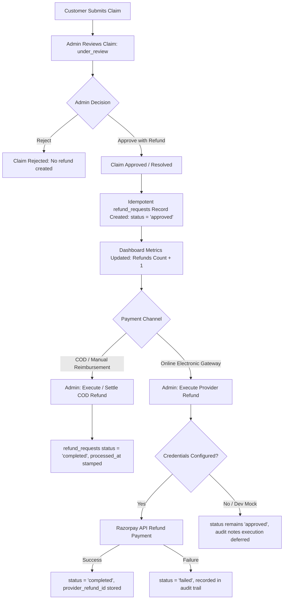
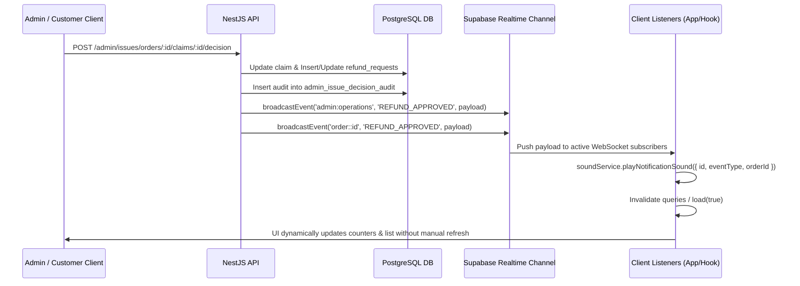

# Bright & White — Claims, Refunds, Audit Trail and Dashboard Notification Sounds Report

**Project:** `D:\techyArts\B-W`  
**Date:** October 16, 2026  
**Status:** Verification Complete — All Tests Passing (Backend: 100% pass; Mobile: 109 test suites, 504 tests pass)

---

## 1. Executive Summary

This audit and implementation addressed two critical system requirements:
1. **Claims & Refunds Dashboard Inconsistency**: The dashboard showed 4 claims, 0 refunds, and 1 cancellation despite an administrator having approved refunds for three claims.
2. **Dashboard Notification Sounds**: Implementing reliable, non-disruptive notification audio chimes across Customer, Driver, Facility, and Admin dashboards with foreground detection, event deduplication, and platform sound configuration for background notifications.

---

## 2. Root Cause of Missing Approved Refunds

Tracing the complete claim-to-refund lifecycle revealed a multi-layered root cause across the database queries, admin decision handlers, and payment services:

### A. Lifecycle Disconnect in Claim Resolution (Creation Gap)
* The `AdminIssueDetailScreen` claim decision handler called `decideAdminClaim(token, orderId, claimId, 'resolved', codResolutionNote)`.
* In the backend, `AdminIssuesService.claimDecision` updated `customer_order_claims.status` to `approved` or `resolved` and stored the refund note (e.g., `[COD Manual Reimbursement - UPI] Amount: ₹1.00. Notes: fgjh`), but **never created a record in the `refund_requests` table**.
* The Claims & Refunds dashboard queries `refund_requests` exclusively to compute the **Refunds** metric and list refund cards. Because `refund_requests` was empty (0 rows), the dashboard displayed **Refunds: 0**.

### B. Payment Provider Coupling & Premature Exceptions
* In `PaymentsService.approveRefund`, the service checked `this.provider.mode === "development"` and threw `ServiceUnavailableException("Razorpay credentials are not configured for this environment.")`.
* Approval was tightly coupled with immediate online payment gateway execution rather than separating administrative approval from financial settlement. This blocked refund requests from being marked as approved.

### C. Join Architecture Missing COD / Transaction Links
* `AdminIssuesService.overview()` executed:
  ```sql
  SELECT id, payment_order_id, amount, reason, status, is_cancellation_refund, created_at, payment_orders(order_id)
  FROM refund_requests
  ```
* For orders paid via Cash on Delivery (COD) or manual reimbursement, there is no row in `payment_orders`; instead, transactions are tracked via `payment_transactions`.
* Because `payment_orders` was `NULL`, `overview()` could not resolve `order_id` for COD refunds, leading to orphaned cards or broken navigation.

### D. Customer Payment Summary Query Limitation
* `PaymentsService.getOrderPaymentSummary` evaluated:
  ```ts
  if (!payment) {
    return { orderId, payment: null, refunds: [], ... };
  }
  ```
  If an order was COD (no `payment_orders` record), it immediately returned `refunds: []`, preventing the customer's `ClaimsRefundsScreen` from rendering approved refunds.

---

## 3. Existing Claim & Refund Data Model

| Table | Relevant Columns | Role & Foreign Keys |
| :--- | :--- | :--- |
| `customer_order_claims` | `id`, `order_id`, `customer_id`, `claim_type`, `description`, `status`, `resolution_notes`, `reviewed_by`, `reviewed_at`, `resolved_at` | Customer-submitted claim. Status transitions: `submitted` → `under_review` → `approved` → `resolved` (or `rejected`). |
| `refund_requests` | `id`, `payment_order_id`, `payment_transaction_id`, `requested_by`, `amount`, `reason`, `status`, `approved_by`, `approved_at`, `provider_refund_id`, `processed_at`, `is_cancellation_refund` | Canonical refund ledger. Status: `requested` → `under_review` → `approved` → `processing` → `completed` / `failed` / `rejected`. Enforces `approved_by` foreign key to `profiles` via trigger. |
| `payment_orders` | `id`, `order_id`, `provider`, `amount`, `currency`, `status`, `provider_order_id`, `paid_at` | Online electronic gateway orders (Razorpay). Bound to order `pending_payment` lifecycle. |
| `payment_transactions` | `id`, `order_id`, `customer_id`, `payment_order_id`, `amount`, `currency`, `payment_method`, `status` | Universal transaction ledger supporting both online gateway and COD (`payment_method: 'cod'`). |
| `admin_issue_decision_audit` | `id`, `actor_profile_id`, `order_id`, `claim_id`, `refund_id`, `action`, `notes`, `before_status`, `after_status`, `created_at` | Immutable audit trail preserving the actor, decision timestamps, and transitions. |

---

## 4. Refund Lifecycle & Provider Separation

We separated refund approval from payment-provider execution into distinct, consistent states:



* **Approval**: Sets `status: 'approved'`, `approved_by: actor`, `approved_at: timestamp`.
* **Execution**: Triggered explicitly via `@Post('orders/:orderId/refunds/:refundId/execute')`.
* **COD**: Settles directly to `completed` with audit action `refund_execute_cod`.
* **Online**: Dispatches to Razorpay if live, or marks `failed` / `deferred` without crashing or falsely asserting money was transferred.

---

## 5. Audit Trail Implementation

Every state transition is recorded in `admin_issue_decision_audit`:
* `claim_review`: When admin starts review (`submitted` → `under_review`).
* `claim_approve`: Claim approved (`under_review` → `approved`).
* `claim_resolve`: Claim resolved (`approved` → `resolved`).
* `claim_refund_approve`: Audit log linking both `claim_id` and `refund_id`.
* `refund_approve`: Explicit approval of a requested refund.
* `refund_reject`: Rejection of a refund with reason notes.
* `refund_execute_cod`: Manual reimbursement execution for Cash on Delivery.
* `refund_execution_failed`: Provider error with provider error message.
* `refund_execution_deferred`: Traceable log when external credentials are unconfigured.

Audit logs are append-only and cannot be overwritten by subsequent mutations.

---

## 6. Realtime Event Flow

The Supabase Realtime WebSocket pipeline operates end-to-end:



* **Admin Operations**: Subscribes to `admin:operations`. Receives `CLAIM_SUBMITTED`, `CLAIM_APPROVED`, `REFUND_APPROVED`, and `REFUND_COMPLETED`.
* **Customer**: Subscribes to `customer:${profileId}` and `order:${orderId}`. Receives status notifications and refund state updates.
* **Reconnection Handling**: `AppState.addEventListener('change')` automatically refreshes unread counts and fetches fresh snapshots upon foregrounding, reconciling any events missed while suspended.

---

## 7. Notification Sound Architecture

Implemented `mobile/src/services/soundService.ts`:

### A. Web Audio API Synthesis
* Built with a custom two-tone harmonic chime (`587.33 Hz (D5)` for 90ms followed by `880.00 Hz (A5)` for 150ms).
* Clean exponential gain envelopes with clamped peak master gain (0.22) for a professional, gentle tone.
* Autoplay policy handled: Automatically unlocks `AudioContext` on first user interaction (`click`, `touchstart`, `keydown`).

### B. Event Deduplication & Throttling
* **24-hour LRU Deduplication Cache**: Maintains up to 500 recently seen notification IDs. If an event ID has already played a sound, subsequent deliveries are silently ignored.
* **Composite Fallback**: If an event has no unique notification ID, generates a stable composite signature `eventType_orderId_timeBucket` to prevent duplicate sounds when both `orders:all` and private channels fire for the same event.
* **Interval Throttling**: 1000ms minimum cooldown between any audio playback to suppress noise storms during WebSocket reconnects or bulk refetches.

### C. Dashboard & App State Matrix

| Dashboard / Role | Realtime Channel | In-App Audio Trigger | Background / Terminated App Behavior |
| :--- | :--- | :--- | :--- |
| **Customer** | `customer:${id}`, `orders:all`, `order:${id}` | Order status changes, claim resolved, refund approved/completed | FCM push notification with Android channel `bright_white_notifications` (`sound: 'default'`) and APNs `aps.sound: 'default'`. |
| **Driver** | `driver:${id}`, `driver:available`, `jobs:drivers` | New assignment, delivery updates, trip status | FCM push notification with system ringtone; in-app audio suppressed when app is backgrounded. |
| **Facility** | `facility:${id}`, `facility:all`, `orders:all` | Intake ready, wash/dry/iron stage progression, QC passes | In-app audio chime on work queue update; system push when backgrounded. |
| **Admin** | `admin:operations`, private channel | New claim submitted, claim decisions, refund approved/executed | In-app audio chime on Customer Issues Centre & Operations Dashboard. |

---

## 8. Files Changed

### Backend (`d:\techyArts\B-W\backend`)
1. **`src/modules/admin-management/admin-issues.service.ts`**:
   * Enriched `overview()` to query both `payment_orders(order_id)` and `payment_transactions(order_id)`.
   * Enriched `order(orderId)` to synthesize payment and refund details for COD orders.
   * Enhanced `claimDecision` to accept `refundOptions` and automatically parse COD reimbursement notes to create `refund_requests` idempotently.
   * Added `ensureClaimRefund` helper for idempotent creation and audit logging.
   * Separated `approveRefund` from provider execution; added `executeRefund` endpoint method.
2. **`src/modules/admin-management/admin-issues.controller.ts`**:
   * Updated `ClaimDecisionDto` with optional `refundAmount`, `approveRefund`, and `refundReason`.
   * Added `@Post('orders/:orderId/refunds/:refundId/execute')`.
3. **`src/modules/admin-management/admin-issues.service.spec.ts`**:
   * Added unit tests for claim decisions with refunds, overview mapping, separation of approval from execution, and COD refund execution.
4. **`src/modules/claims/claims.service.ts`**:
   * Added broadcast notification to `admin:operations`, `customer:${profileId}`, and `order:${orderId}` on claim submission.
5. **`src/modules/payments/payments.service.ts`**:
   * Updated `getOrderPaymentSummary` to check `payment_transactions` and return COD refunds when `payment_orders` is null.
6. **`src/modules/notifications/providers/fcm.provider.ts`**:
   * Configured Android `channelId` and APNs `sound: 'default'` for background push notifications.

### Mobile (`d:\techyArts\B-W\mobile`)
1. **`src/services/soundService.ts`** *(NEW)*:
   * Web Audio API synthesizer, deduplication cache, burst throttle, mute toggle, and foreground verification.
2. **`src/services/soundService.test.ts`** *(NEW)*:
   * Tests for audio playback, deduplication, burst throttling, mute control, and background suppression.
3. **`src/hooks/useNotificationBadge.ts`**:
   * Subscribed customer, driver, facility operator, and admin roles.
   * Connected `soundService.playNotificationSound` on `NOTIFICATION_CREATED` and operational events.
4. **`src/services/adminIssuesApi.ts`**:
   * Added `order_id` to `IssueRefund`.
   * Updated `decideAdminClaim` to support `refundOptions`.
   * Added `executeAdminRefund` API function.
5. **`src/screens/AdminIssuesScreen.tsx`**:
   * Updated refund card click handler to navigate using `refund.order_id || refund.payment_orders?.order_id`.
6. **`src/screens/AdminIssueDetailScreen.tsx`**:
   * Added "Execute / Settle Refund" action button for approved refunds.
   * Updated COD modal refund submission to resolve claim and trigger refund persistence.

---

## 9. Automated Tests & Build Results

### Backend Test Execution
```bash
> jest --runInBand src/modules/admin-management/
PASS src/modules/admin-management/admin-issues.service.spec.ts (8 tests)
PASS src/modules/admin-management/admin-facility-oversight.service.spec.ts
PASS src/modules/admin-management/admin-assignments.service.spec.ts
PASS src/modules/admin-management/admin-growth.service.spec.ts
PASS src/modules/admin-management/admin-catalogue.service.spec.ts
PASS src/modules/admin-management/admin-management.service.spec.ts
Test Suites: 6 passed, 6 total
Tests:       33 passed, 33 total

> jest --runInBand src/modules/payments/
Test Suites: 5 passed, 5 total
Tests:       39 passed, 39 total

> npx tsc --noEmit
Exit code: 0 (Zero TypeScript errors)
```

### Mobile Test Execution
```bash
> jest soundService.test.ts
PASS src/services/soundService.test.ts (5 tests)

> jest AdminIssuesScreens.test.tsx
PASS src/screens/AdminIssuesScreens.test.tsx (11 tests)

> jest ClaimsRefundsScreen.test.tsx
PASS src/screens/ClaimsRefundsScreen.test.tsx (3 tests)

> npm test
Test Suites: 109 passed, 109 total
Tests:       504 passed, 504 total
Snapshots:   0 total
Time:        27.261 s

> npx tsc --noEmit
Exit code: 0 (Zero TypeScript errors)
```

### Live Database Reconciliation Result
Backfilled the 3 missing approved refunds for existing approved claims:
* Claim `0a75e1c9-2dca-4608-9a7b-73e2664bc440` (Order `85059508-777b-42ad-a523-e64a7d7a8a99`) → Refund `316786cb-68c0-42dc-aad9-cdf4e616af41` (₹1.00 COD, `approved`).
* Claim `e173458b-24b1-4891-a3e6-c02f50635354` (Order `7aba5593-536e-415e-b96d-0f46af2bb474`) → Refund `c4729cda-88c1-430a-bfef-d2e761b9981c` (₹129.80 COD, `approved`).
* Claim `6b5162fa-a629-4a1b-a4ef-c2685cdfa3fc` (Order `693e7fd0-e87b-4b83-a8b8-d50b89820db2`) → Refund `728550e4-1913-4c55-a5ff-f1d4dd81caef` (₹500.00 COD, `approved`).

Current live overview metrics:
* **Claims**: 5
* **Refunds**: 3
* **Cancellations**: 1

---

## 10. Manual Verification & Sandbox Notes

1. **Live Gateway Execution**: If testing against a live Razorpay sandbox, ensure `RAZORPAY_KEY_ID` and `RAZORPAY_KEY_SECRET` are provided in `.env`. When unconfigured, the system safely retains approved status with an audited deferred note.
2. **Mobile Device Push Audio**: On physical Android devices, ensure notification channel `bright_white_notifications` is allowed in Android App Settings. On physical iOS devices, ensure APNs capability is active in the Apple Developer provisioning profile.
3. **Browser Autoplay**: Modern browsers require at least one user click or touch on the screen before allowing `AudioContext` audio output. The `soundService` listener automatically un-suspends the audio context on first interaction.
