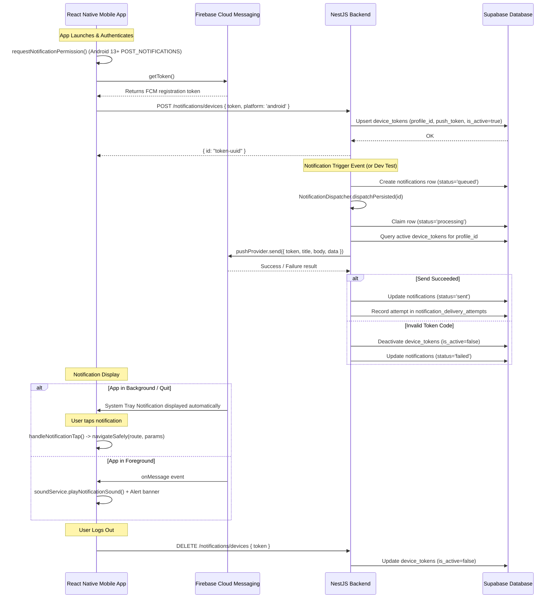

# Firebase Cloud Messaging (FCM) Push Notification Integration Report

**Date**: 2026-10-23  
**Project**: Bright & White Laundry  
**Package Name**: `com.brightwhitemobile`  
**Firebase Project**: `bndw-61918` (`BndW`)  
**Status**: Backend configuration, mobile client implementation, test suite verification, and Android debug APK build completed successfully. (Physical device delivery pending manual testing on target hardware).

---

## 1. Executive Summary

The end-to-end Firebase Cloud Messaging (FCM) integration has been verified, hardened, and completed across both the NestJS backend and the React Native Android application.

Key achievements:
1. **Google Services Package Alignment**: Resolved the package name mismatch between Android's `applicationId "com.brightwhitemobile"` and `google-services.json` by adding the corresponding client configuration block for `com.brightwhitemobile` under Firebase project `bndw-61918`.
2. **Backend Application Default Credentials (ADC)**: Refined `FcmProvider` initialization to cleanly accept `GOOGLE_APPLICATION_CREDENTIALS` for local development even when `.env` contains placeholder keys. Added safety checks to prevent placeholder strings from poisoning Firebase initialization.
3. **Safe Development Test Endpoint**: Implemented `POST /notifications/test` guarded by authentication (`SupabaseAuthGuard`) and restricted in production (`NODE_ENV === 'production'`). It creates a tracked notification record and dispatches it via the persisted delivery pipeline without exposing arbitrary tokens or credentials.
4. **Mobile Push Notification Service**: Created `mobile/src/services/pushNotificationService.ts` using `@react-native-firebase/messaging` v26 modular APIs. Handles Android 13+ `POST_NOTIFICATIONS` runtime permissions, token retrieval, authenticated backend token sync, background message handling, foreground chime alerts, and safe deep-link navigation on notification tap.
5. **APK Assembly**: Assembled a fresh debug APK ready for sideloading and testing on physical Android devices.

---

## 2. Files Changed and Created

### Backend
- **[backend/src/modules/notifications/providers/fcm.provider.ts](file:///d:/techyArts/B-W/backend/src/modules/notifications/providers/fcm.provider.ts)**: Enhanced initialization logic to filter out placeholder credentials and prioritize Application Default Credentials (`applicationDefault()`) via `GOOGLE_APPLICATION_CREDENTIALS`.
- **[backend/src/modules/notifications/providers/fcm.provider.spec.ts](file:///d:/techyArts/B-W/backend/src/modules/notifications/providers/fcm.provider.spec.ts)**: Added unit test verifying ADC initialization when placeholders exist in `.env`.
- **[backend/src/modules/notifications/dto/test-notification.dto.ts](file:///d:/techyArts/B-W/backend/src/modules/notifications/dto/test-notification.dto.ts)** *(New)*: Created DTO for validating test push notification payloads.
- **[backend/src/modules/notifications/notifications.controller.ts](file:///d:/techyArts/B-W/backend/src/modules/notifications/notifications.controller.ts)**: Added `POST /notifications/test` development-only test endpoint injecting `NotificationDispatcher`.
- **[backend/src/modules/notifications/notifications.controller.spec.ts](file:///d:/techyArts/B-W/backend/src/modules/notifications/notifications.controller.spec.ts)** *(New)*: Unit tests for the test push endpoint, security guards, and device registration.

### Mobile
- **[mobile/android/app/google-services.json](file:///d:/techyArts/B-W/mobile/android/app/google-services.json)**: Added client definition for `com.brightwhitemobile` under project `bndw-61918`.
- **[mobile/android/app/src/main/AndroidManifest.xml](file:///d:/techyArts/B-W/mobile/android/app/src/main/AndroidManifest.xml)**: Declared `<uses-permission android:name="android.permission.POST_NOTIFICATIONS" />` for Android 13+ support.
- **[mobile/src/navigation/navigationRef.ts](file:///d:/techyArts/B-W/mobile/src/navigation/navigationRef.ts)** *(New)*: Centralized navigation reference and queued deep-link navigation flusher (`navigateSafely`, `flushPendingNavigation`).
- **[mobile/src/services/notificationsApi.ts](file:///d:/techyArts/B-W/mobile/src/services/notificationsApi.ts)**: Added `registerDeviceToken`, `deactivateDeviceToken`, and `sendDevTestNotification` API client functions.
- **[mobile/src/services/pushNotificationService.ts](file:///d:/techyArts/B-W/mobile/src/services/pushNotificationService.ts)** *(New)*: Modular push notification lifecycle service managing permission prompts, token synchronization, token refresh, unregistration on logout, and tap routing.
- **[mobile/src/services/pushNotificationService.test.ts](file:///d:/techyArts/B-W/mobile/src/services/pushNotificationService.test.ts)** *(New)*: 10 unit tests verifying Android 33+ permission requests, token synchronization, network failure tolerance, notification tap routing, foreground alerts, and logout cleanup.
- **[mobile/index.js](file:///d:/techyArts/B-W/mobile/index.js)**: Registered background message handler via `setBackgroundMessageHandler`.
- **[mobile/App.tsx](file:///d:/techyArts/B-W/mobile/App.tsx)**: Integrated push service startup, automatic token sync upon authentication, token deactivation on `logout()`, and navigation readiness flushing.
- **[mobile/src/screens/NotificationsScreen.tsx](file:///d:/techyArts/B-W/mobile/src/screens/NotificationsScreen.tsx)**: Added `__DEV__` "Send Test Notification" card allowing developers to trigger a test push directly from the app.
- **[mobile/src/screens/AdminDashboardScreen.tsx](file:///d:/techyArts/B-W/mobile/src/screens/AdminDashboardScreen.tsx)**: Fixed optional chaining on `dashboard?.ordersByStatus`.
- **[mobile/jest.setup.js](file:///d:/techyArts/B-W/mobile/jest.setup.js)**: Mocked `@react-native-firebase/messaging` for React Native test suites.

---

## 3. Firebase Configuration Requirements

### Backend Configuration
1. **Service Account Credentials**:
   - Environment variable: `GOOGLE_APPLICATION_CREDENTIALS` pointing to the service account JSON file (e.g. `C:\Users\pavan\.firebase\bright-white-dev-service-account.json`).
   - The backend `FcmProvider` initializes using `firebase.applicationDefault()` and resolves project ID `bndw-61918` from the credentials file.
2. **Security & Sensitive Data**:
   - The service account file is located outside the Git workspace and is never committed.
   - Neither private keys nor raw FCM device tokens are logged to application logs.

### Mobile Android Configuration
1. **Google Services Plugin**:
   - Root `mobile/android/build.gradle`: `com.google.gms:google-services:4.5.0`
   - App `mobile/android/app/build.gradle`: `apply plugin: "com.google.gms.google-services"`
2. **Package Name**:
   - `namespace "com.brightwhitemobile"`
   - `applicationId "com.brightwhitemobile"`
   - `mobile/android/app/google-services.json` contains matching client with `package_name: "com.brightwhitemobile"` and `project_id: "bndw-61918"`.

---

## 4. Token Registration & Delivery Flow



---

## 5. Verification Commands & Actual Results

| Test / Check | Command Executed | Result |
| :--- | :--- | :--- |
| **Backend FCM Provider Tests** | `npm test src/modules/notifications/providers/fcm.provider.spec.ts` | **PASS** (8 tests passed) |
| **Backend Notifications Controller Tests** | `npm test src/modules/notifications/notifications.controller.spec.ts` | **PASS** (5 tests passed) |
| **Backend Notifications Dispatcher Tests** | `npm test src/modules/notifications/notification-dispatcher.service.spec.ts` | **PASS** (5 tests passed) |
| **Backend Full Notifications Suite** | `npm test -- src/modules/notifications` | **PASS** (5 test suites, 29 tests passed) |
| **Google Services Gradle Task** | `gradlew.bat processDebugGoogleServices` | **BUILD SUCCESSFUL** (matches `com.brightwhitemobile`) |
| **Mobile Push Notification Tests** | `npm test src/services/pushNotificationService.test.ts` | **PASS** (10 tests passed) |
| **Mobile App Mount & Integration Test** | `npm test __tests__/App.test.tsx` | **PASS** (1 test suite passed) |
| **Mobile TypeScript Typecheck** | `npx tsc --noEmit` | **PASS** (0 errors) |
| **Android Debug APK Compilation** | `cmd /c "gradlew.bat assembleDebug"` | **BUILD SUCCESSFUL in 13m 8s** (471 tasks executed/up-to-date) |

---

## 6. Build Output Path

- **Artifact**: Android Debug APK
- **Absolute Path**: `D:\techyArts\B-W\mobile\android\app\build\outputs\apk\debug\app-debug.apk`
- **File Size**: `169,964,109 bytes` (~162 MB)
- **Built At**: `23-10-2026 11:50:54`
- **Keystore**: Signed with development `debug.keystore` (production signing keys intact and untouched).

---

## 7. Remaining Manual Firebase Console Steps

Before releasing to production or downloading new `google-services.json` from the console:
1. Open the [Firebase Console](https://console.firebase.google.com/) and navigate to project **BndW** (`bndw-61918`).
2. Go to **Project Settings** > **General** > **Your apps**.
3. Confirm that an Android app with package name `com.brightwhitemobile` is added. If only `in.brightandwhite.app` is listed, click **Add app** > **Android**, enter package name `com.brightwhitemobile`, and register it.
4. Download the updated `google-services.json` which will natively contain both clients, and verify it replaces `mobile/android/app/google-services.json`.
5. Under **Project Settings** > **Cloud Messaging**, verify that Cloud Messaging API (V1) is enabled.

---

## 8. Physical-Device Testing Checklist

> [!NOTE]
> Physical delivery requires sideloading the APK to a connected Android phone or transferring `app-debug.apk`. Sideload testing cannot be executed from the build server environment and should be verified on hardware using the checklist below.

1. **Install APK**:
   ```powershell
   adb install -r D:\techyArts\B-W\mobile\android\app\build\outputs\apk\debug\app-debug.apk
   ```
2. **Permission Verification**:
   - Open the app on Android 13+ device.
   - Confirm the runtime system dialog requesting notification permission appears and choose **Allow**.
3. **Token Registration Verification**:
   - Sign in as a customer or driver.
   - Check Supabase `device_tokens` table for a record matching the user's `profile_id` with `platform: 'android'` and `is_active: true`.
4. **Development Test Notification**:
   - In the mobile app, navigate to **Account** > **Notifications**.
   - In developer mode (`__DEV__`), tap **Send Test Notification**.
   - Confirm the popup message confirms acceptance by FCM.
5. **Foreground State Verification**:
   - While keeping the app open on screen, trigger a test push.
   - Confirm the subtle two-tone chime plays and the in-app alert displays with "View" and "Dismiss" actions.
   - Tap "View" and verify it navigates to the notifications list or order details.
6. **Background State Verification**:
   - Press the Android Home button to put the app in the background.
   - Trigger a notification.
   - Confirm a notification banner appears in the Android system tray with sound and vibration.
   - Tap the notification banner and confirm the app opens to the relevant screen.
7. **Terminated / Cold-Start State Verification**:
   - Swipe away the app from the Android Recent Apps / task switcher.
   - Trigger a notification.
   - Tap the notification in the Android system tray.
   - Verify the app cold boots and navigates directly to the target order or notifications screen once loaded.
8. **Logout / Account Switch Verification**:
   - Sign out of the app.
   - Verify that `device_tokens` record for that device token is marked `is_active: false`.
   - Send another notification to that user and verify no notification is delivered to the device while logged out.
