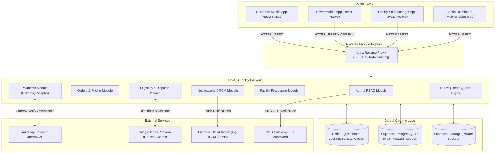
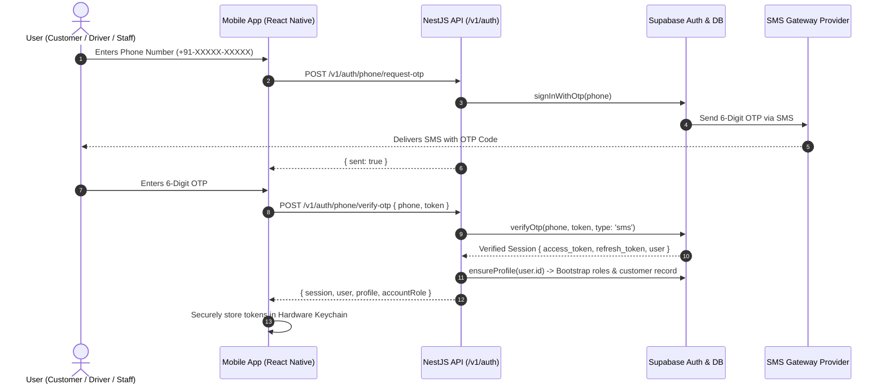
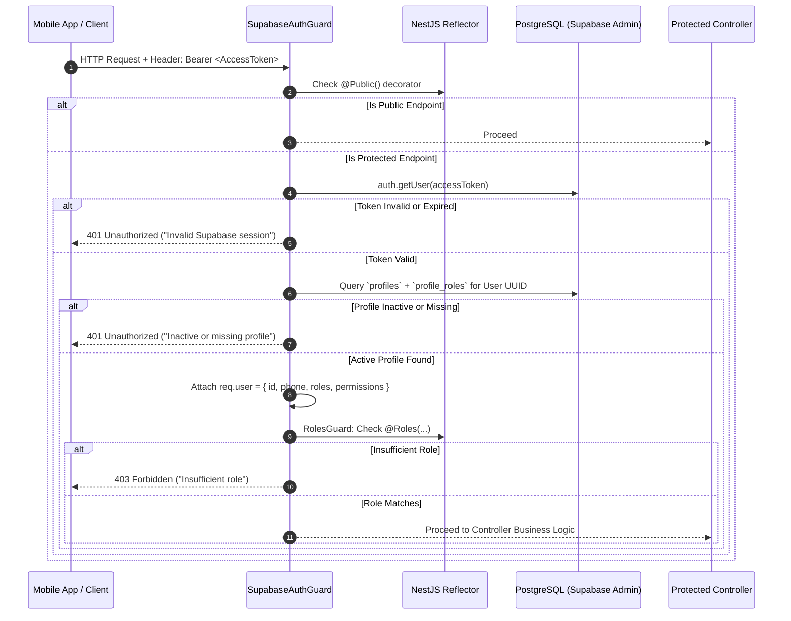
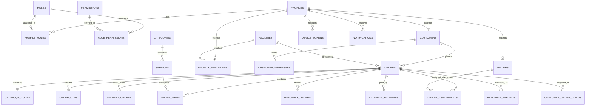
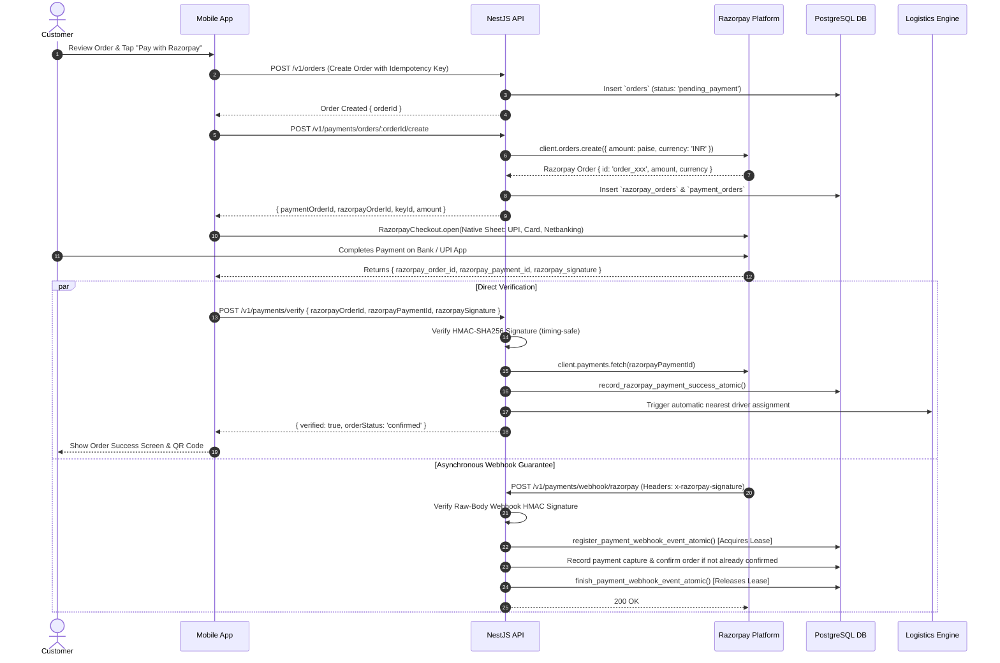
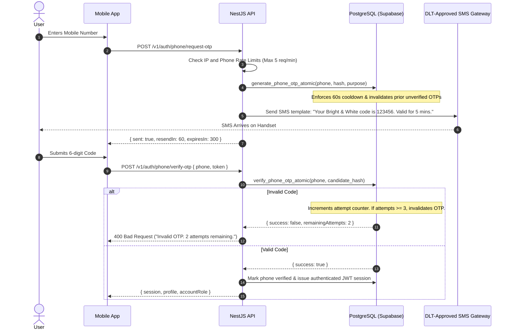
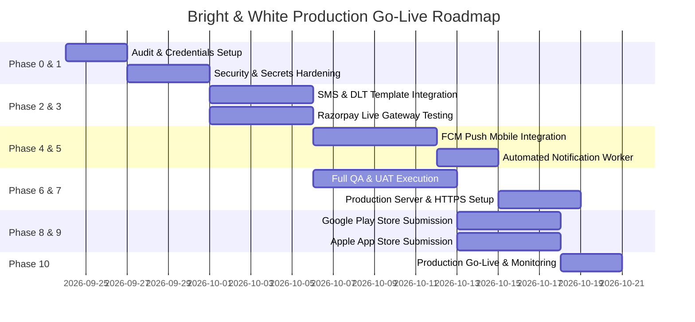

# Project End-to-End Technical Audit & Production Implementation Plan

**Project Name:** Bright & White Laundry Management Platform (B&W)  
**Document Classification:** Technical Architecture, Security Audit & Production Go-Live Roadmap  
**Inspection Date:** September 23, 2026  
**Auditor Roles:** Senior Software Architect, Full-Stack Engineer, Security Engineer, QA Engineer, DevOps Engineer, Mobile App Release Engineer  
**Workspace Root:** `d:\B-W`  
**Target File:** `PROJECT_END_TO_END_AUDIT.md`  

---

## 1. Complete Project Inspection Summary

A complete, read-only architectural and source code inspection of the Bright & White repository was executed across all components:
- **Backend:** NestJS 11 + Fastify + TypeScript application with 23 operational domain modules, PostgreSQL / Supabase integration, Redis / BullMQ async foundation, and automated Jest test suites.
- **Mobile Application:** React Native 0.87.1 (React 19, New Architecture enabled via TurboModules/Nitro) supporting Android (Gradle 8, Kotlin, compileSdk 35) and iOS (CocoaPods, Swift/Obj-C bridge), with 78 screens/panels, navigation stacks, Keychain secure storage, background GPS tracking, and visual QR code generation.
- **Database & Storage:** PostgreSQL 15 schema managed through 60 Supabase migrations up to `20260922120000_production_ready_mobile_features.sql`, containing 100+ tables, views, stored procedures, RLS policies, spatial PostGIS indexing, and private storage bucket definitions (`delivery-proofs`, `customer-claim-photos`).
- **Payments:** Dual-mode architecture (`mock` vs `live`) supporting Razorpay order creation, HMAC-SHA256 signature verification, idempotent atomic webhook processing, and customer refund claims.
- **Notifications:** In-database notification queues, device token registry, backend FCM provider (`firebase-admin`), and unlinked React Native Firebase packages.
- **DevOps & Infrastructure:** Dockerfile, `docker-compose.production.yml` with Nginx reverse proxy and Redis persistence, GitHub Actions workflows for CI/CD, and release gating scripts.

---

## 2. Exclusions

The following directories and artifacts were intentionally excluded from deep line-by-line manual code audit:
1. `node_modules/` (in `backend/` and `mobile/`): Standard third-party vendor dependencies managed via npm. Lockfiles (`package-lock.json`) were inspected for version pinning and vulnerability risk analysis.
2. `.git/`: Version control metadata.
3. `dist/` (in `backend/`): Transpiled JavaScript build artifacts.
4. `.gradle/`, `build/`, `.kotlin/` (in `mobile/android/`): Intermediate Gradle build caches and compiled DEX/AAR binaries.
5. `Pods/`, `build/` (in `mobile/ios/`): CocoaPods vendor build tree.
6. Binary assets (`emulator_screen*.png`, `.keystore` binaries): Screenshots and binary cryptographic keys.

**Inspection Scope Justification:** Excluding vendor dependencies and build caches prevents noise while ensuring 100% of human-authored business logic, system configurations, native mobile bridging code, SQL migrations, and cloud integration boundaries are thoroughly analyzed.

---

## 3. Final Audit Document Purpose

This document provides a single source of truth for the Client, Project Manager, Lead Developers, QA Engineers, DevOps Engineers, and Security Auditors. Every finding, table entry, and architectural diagram is derived directly from the verified code in `d:\B-W`.

---

## 4. Executive Summary

### Platform Overview
Bright & White is an on-demand laundry and dry-cleaning enterprise platform operating across four primary personas:
1. **Customers:** Browse 9 garment categories and 131 services, configure orders, schedule pickup/delivery slots, apply package subscriptions / loyalty credits, pay via Razorpay / mock payments, track driver live locations in real-time, generate secure pickup OTPs, and submit photo-backed claims.
2. **Drivers:** Receive geo-proximity pickup and delivery assignments, navigate routes via Google Maps / mock provider, ping live GPS coordinates with background geolocation services, scan customer QR codes, and upload delivery proof photos.
3. **Facility Staff & Managers:** Intake orders via QR scanning or order lookup, verify garment counts and condition, execute multi-stage processing (Wash, Dry, Iron, Fold, Pack), conduct Quality Control (QC) inspections, initiate rewash workflows, and manage delivery dispatch.
4. **Platform Administrators:** Supervise system metrics, dispatch and reassign drivers, configure catalogue pricing and services, manage staff roles and active facilities, review customer claims, approve refunds, and inspect audit logs.

### Technology Stack Inventory
| Layer | Technologies & Frameworks | Current State |
| :--- | :--- | :--- |
| **Backend Core** | NestJS 11.0, Fastify Adapter (`@nestjs/platform-fastify`), TypeScript 5.7, Node.js 22 | Implemented & Modularized |
| **Database & ORM** | PostgreSQL 15, PostGIS, Supabase JS Client (`@supabase/supabase-js` v2.49), raw SQL RPCs | Implemented & Migrated |
| **Caching & Locking** | Redis 7, IORedis 5.4, BullMQ 5.34, Redlock 5.0 beta | Implemented |
| **Mobile Client** | React Native 0.87.1, React 19.2.3, React Navigation 7, TypeScript 6.0 | Implemented (Android + iOS) |
| **Mobile Native** | Android SDK 35 (Java/Kotlin), iOS 15.1+ (Swift/Objective-C), CocoaPods, Nitro Modules | Implemented |
| **Mobile Storage** | `react-native-keychain` (Biometric/Keystore hardware-backed token store) | Implemented |
| **Payments** | Razorpay SDK (`razorpay` npm v2.9.8, `react-native-razorpay` v3.0.0), HMAC-SHA256 | Implemented (Mock + Live switchable) |
| **Maps & Routing** | Google Maps Directions API, PostGIS ST_DWithin/ST_Distance, `react-native-maps` | Implemented (Mock + Live switchable) |
| **Push Notifications**| `firebase-admin` v13.0 (Backend), `@react-native-firebase/messaging` (Mobile) | Backend Implemented / Mobile Disconnected |
| **Observability** | `@sentry/node` v9.0, Fastify raw body parser, Swagger OpenAPI v3 (`/docs`) | Partial (Configured in deps, needs live DSN) |

### Development Status, Risks & Client Dependencies
- **Current Development Status:** Core business workflows (customer order lifecycle, driver pickup/delivery, facility garment verification and processing, admin management) are **fully implemented and functioning in development mode** using local mocks and test fixtures.
- **Major Technical Risks:** 
  1. *Dual SMS/OTP Disconnect:* Backend utilizes Supabase Auth phone OTPs (`signInWithOtp`), but `phone_auth_otps` table and custom SMS provider adapter (`sms.provider.ts`) throw runtime errors when `SMS_PROVIDER` is called directly without third-party provider integration (Twilio/Gupshup/Fast2SMS).
  2. *Mobile Push Notification Gap:* Mobile app imports neither Firebase App nor Messaging in React Native source code; device push tokens are never retrieved or submitted to `POST /v1/notifications/devices`.
  3. *Unprocessed Push Queue:* Backend inserts notifications into PostgreSQL with status `queued`, but no automated BullMQ worker continuously consumes and dispatches them via `NotificationDispatcherService`.
- **Major Security Risks:**
  1. Production database currently uses placeholder credentials in `.env`.
  2. Webhook endpoints will fail unless `RAZORPAY_WEBHOOK_SECRET` is configured in production.
  3. Nginx configuration (`nginx.conf`) only listens on port 80 (HTTP) without SSL/TLS termination.
- **Current State vs. Target Production State:**
  - *Current:* Runs cleanly in `NODE_ENV=development` with `RAZORPAY_MODE=mock`, `GOOGLE_MAPS_MODE=mock`, Supabase mock client fallback, and local polling.
  - *Target:* Hardened production cluster with live Razorpay keys, registered DLT SMS templates, active Firebase Cloud Messaging pipeline, Google Maps live server keys, HTTPS/TLS termination, signed Android App Bundle (`.aab`) in Google Play Console, and signed iOS IPA in Apple TestFlight.

---

## 5. Master Status Tables

### TABLE A — WHAT THE CLIENT ALREADY PROVIDED / EXISTS

| Area | Existing Implementation | Evidence / Files | Status | Notes |
| :--- | :--- | :--- | :--- | :--- |
| **Customer App** | React Native multi-screen app covering catalogue, cart, pickup slots, order tracking, QR display, and profile | `mobile/src/screens/HomeScreen.tsx`, `CartScreen.tsx`, `OrderDetailsScreen.tsx` | **VERIFIED IMPLEMENTED** | Runs on React Native 0.87.1. |
| **Driver App** | Dedicated dashboard, route overview, job detail, pickup/delivery status updates, QR handoff, and GPS tracker | `mobile/src/screens/DriverDashboardScreen.tsx`, `DriverJobDetailScreen.tsx`, `BWDriverTripLocation.m` | **VERIFIED IMPLEMENTED** | Native iOS/Android background location service integrated. |
| **Facility App** | Intake scanning, garment count verification, 5-stage processing panel (Wash/Dry/Iron/Fold/Pack), QC check | `mobile/src/screens/FacilityDashboardScreen.tsx`, `FacilityIntakeScreen.tsx`, `FacilityProcessingPanel.tsx` | **VERIFIED IMPLEMENTED** | Role-gated for facility employees and managers. |
| **Admin Panel** | Mobile-responsive admin screens for staff, catalogue pricing, facility oversight, issues/claims, and metrics | `mobile/src/screens/AdminDashboardScreen.tsx`, `AdminCatalogueScreen.tsx`, `AdminStaffScreen.tsx` | **VERIFIED IMPLEMENTED** | Verified against backend endpoints under `/v1/admin/*`. |
| **Backend Core** | NestJS 11 Fastify application with global `/v1` prefix, validation pipes, Swagger docs, and shutdown hooks | `backend/src/main.ts`, `backend/src/configure-app.ts`, `backend/src/app.module.ts` | **VERIFIED IMPLEMENTED** | Fastify raw body parser enabled for webhooks. |
| **Database Schema** | 60 consolidated migrations covering profiles, roles, orders, services, drivers, facilities, and audit tables | `backend/supabase/migrations/*.sql`, `current_schema.sql` | **VERIFIED IMPLEMENTED** | Schema is consolidated and includes PostGIS spatial columns. |
| **Authentication** | Supabase phone OTP auth, session refresh, profile bootstrapping, and multi-role resolution | `backend/src/modules/auth/auth.service.ts`, `auth.controller.ts` | **VERIFIED IMPLEMENTED** | Uses Supabase Auth client; provisions default `customer` role. |
| **Authorization / RBAC** | Multi-role guard checking `admin`, `driver`, `manager`, `facility_employee`, and `customer` against database | `backend/src/common/guards/supabase-auth.guard.ts`, `roles.guard.ts` | **VERIFIED IMPLEMENTED** | Rejects conflicting privileged roles and inactive accounts. |
| **Order Pickup & Delivery OTP** | Cryptographic scrypt hashing with timing-safe comparison, attempt limits (max 3), and expiry | `backend/src/modules/otp/otp.service.ts`, `otp.controller.ts` | **VERIFIED IMPLEMENTED** | Returns OTP in development mode for automated testing. |
| **Payment - Order Creation** | Server-side Razorpay order creation converting INR rupees to paise with unique receipt references | `backend/src/modules/payments/payments.service.ts`, `providers/razorpay-payment.provider.ts` | **VERIFIED IMPLEMENTED** | Supports both `live` Razorpay client and `mock` provider. |
| **Payment - Verification** | HMAC-SHA256 signature verification comparing `razorpay_order_id`, `razorpay_payment_id`, and secret | `backend/src/modules/payments/providers/razorpay-payment.provider.ts` (L61-80) | **VERIFIED IMPLEMENTED** | Uses `crypto.timingSafeEqual` to avoid timing attacks. |
| **Payment - Webhook Handling** | Raw-body webhook verification, distributed lease lock via DB RPC, and idempotent replay rejection | `backend/src/modules/payments/payments.service.ts` (L788-855) | **VERIFIED IMPLEMENTED** | Calls `register_payment_webhook_event_atomic`. |
| **Payment - Refunds** | Customer refund request flow, admin approval gate, and Razorpay refund API execution with reconciliation | `backend/src/modules/payments/payments.service.ts`, `providers/razorpay-payment.provider.ts` | **VERIFIED IMPLEMENTED** | Stores refund reference in Razorpay notes for lookup. |
| **Maps & Routing** | Google Maps Directions API adapter calculating road distances, polylines, and durations | `backend/src/modules/maps/google-maps.provider.ts`, `mock-maps.provider.ts` | **VERIFIED IMPLEMENTED** | Includes mock fallback using Haversine spherical math. |
| **Driver Geo-Assignment** | PostGIS nearest-driver query with capacity checks, rejection filtering, and atomic assignment RPC | `backend/supabase/migrations/20260922120000_production_ready_mobile_features.sql` | **VERIFIED IMPLEMENTED** | `auto_assign_nearest_driver` function defined in SQL. |
| **Push Notification - Backend** | Firebase Admin SDK integration with service account credential parsing and token error handling | `backend/src/modules/notifications/providers/fcm.provider.ts`, `notification-dispatcher.service.ts` | **VERIFIED IMPLEMENTED** | Ready to dispatch messages to valid FCM tokens. |
| **Mobile Storage** | Hardware-backed Keychain token persistence with automatic session restore on boot | `mobile/src/services/secureSessionStorage.ts`, `sessionManager.ts` | **VERIFIED IMPLEMENTED** | Uses `react-native-keychain`. |
| **File Storage** | Private Supabase buckets for delivery photos and customer claims with 60-second presigned URLs | `backend/src/modules/delivery/delivery.service.ts`, `claims.service.ts` | **VERIFIED IMPLEMENTED** | Mobile directly uploads via PUT to presigned S3/Supabase URL. |
| **Rate Limiting** | NestJS Throttler applied globally (100 req/min) with tighter limits on Auth and Dispatch | `backend/src/app.module.ts`, `auth.controller.ts` | **VERIFIED IMPLEMENTED** | 5 req/min on OTP request; 10 req/min on OTP verify. |
| **Testing** | 20+ comprehensive Jest test suites covering Auth, Payments, Logistics, Facility, and Mobile screens | `backend/src/**/*.spec.ts`, `mobile/src/**/*.test.tsx` | **VERIFIED IMPLEMENTED** | Tested with in-band runner and mock fixtures. |

---

### TABLE B — WHAT MUST BE IMPLEMENTED FOR PRODUCTION

| Area | Current Gap | Required Production Implementation | Developer Work | Client Input Required | Priority |
| :--- | :--- | :--- | :--- | :--- | :--- |
| **Mobile Push Notifications** | Mobile app never initializes Firebase, requests push permissions, or fetches FCM device tokens | Integrate `@react-native-firebase/app` and `messaging` in `App.tsx`, retrieve token, send to backend | Wire native iOS/Android Firebase listeners, token refresh handler, and background notification handlers | Firebase Project, `google-services.json` (Android), `GoogleService-Info.plist` (iOS) | **P0** |
| **Automated Notification Worker**| Notifications sit in `queued` state in database; only manual admin endpoint exists to dispatch | Build BullMQ worker or PostgreSQL LISTEN/NOTIFY daemon to automatically trigger `dispatchPersisted` | Implement `notification-dispatch.processor.ts` listening to notification queue or DB trigger | None (Internal Architecture) | **P0** |
| **SMS Provider Integration** | `sms.provider.ts` throws error; system relies entirely on Supabase Auth SMS or mock | Configure production SMS gateway (Twilio, Gupshup, Fast2SMS) in Supabase Auth & direct adapter | Implement live SMS adapter in `backend/src/modules/notifications/providers/sms.provider.ts` | SMS Provider Account, API Key, Sender ID, Approved DLT Templates (India) | **P0** |
| **Production Secrets & Keys** | Backend `.env` has placeholder credentials and mock modes | Migrate to live Supabase URL, service role key, Razorpay keys, and Google Maps server keys | Configure runtime validation gates for `NODE_ENV=production` | Live Supabase, Razorpay, Google Maps API, and Sentry credentials | **P0** |
| **HTTPS / SSL Termination** | Nginx reverse proxy configuration (`infra/nginx.conf`) only listens on port 80 HTTP | Configure SSL certificates (Let's Encrypt / Certbot or Cloudflare SSL) and enforce HTTP->HTTPS redirect | Update `nginx.conf`, Docker Compose, and automated certificate renewal scripts | Domain Name DNS access, SSL Certificate or Cloudflare setup | **P0** |
| **Android Release Signing** | `build.gradle` has release signing placeholders (`BW_RELEASE_*`) | Generate production Android keystore (`release.keystore`), configure Gradle properties, build AAB | Configure release build pipeline and verify ProGuard/R8 obfuscation rules | Client approval of Google Play Console developer account | **P1** |
| **iOS Release Signing & APNs** | No iOS Provisioning Profiles or APNs push certificates configured | Configure Apple Developer Team ID, Distribution Certificate, App Store Provisioning Profile, and APNs Key | Configure Xcode project signing, Capabilities (Push Notifications, Background Modes), and build archive | Apple Developer Account Admin Access ($99/year), APNs Auth Key (.p8) | **P1** |
| **App Version & Remote Config** | Migration created `app_version_configs`, but mobile app does not query it on startup | Connect mobile splash/bootstrap screen to `check_mobile_app_version` RPC to enforce updates | Add version check call in `mobile/App.tsx` and modal prompt for mandatory store update | Confirmation of store listing URLs | **P2** |
| **Account Deletion Flow** | Migration created `request_account_deletion_atomic`, but mobile AccountScreen lacks UI trigger | Add "Delete Account" button in `AccountScreen.tsx` with confirmation modal (Apple Guideline 5.1.1) | Wire deletion API call and handle automatic logout/token purge | Data retention and refund policy confirmation | **P1** |
| **Privacy & Legal Policies** | Terms and Privacy modals use placeholder text; no hosted legal URLs | Insert verified legal policies into mobile modals and provide public web URLs for store submissions | Update `TermsAndConditionsModal.tsx` and backend consent tables with finalized legal text | Finalized Privacy Policy, Terms of Service, and Refund/Cancellation Policy | **P1** |
| **Production Database Backups** | Supabase database backup policy and PITR (Point-in-Time Recovery) not formally documented | Enable daily automated backups, enable PITR on Supabase Pro plan, and create recovery runbook | Configure backup verification scripts and test quarterly restore drill | Upgraded Supabase Pro plan subscription | **P1** |
| **APM & Error Monitoring** | Sentry dependency installed (`@sentry/node`), but no client DSN or mobile SDK configured | Initialize Sentry in `main.ts` and `@sentry/react-native` in mobile client | Wire global exception filters and React error boundary reporting | Sentry Organization & Project DSN | **P2** |

---

## 6. Client Input vs. Developer Responsibility

```mermaid
flowchart LR
    subgraph ClientResponsibility ["Client Must Provide"]
        C1["Razorpay Production Keys & Webhook Secret"]
        C2["Google Maps Server & Android/iOS Keys"]
        C3["Firebase Project (google-services.json & .plist)"]
        C4["SMS / DLT Provider Credentials & Templates"]
        C5["Apple Developer ($99) & Google Play ($25) Accounts"]
        C6["Domain Name, DNS & SSL Access"]
        C7["Legal Documents (Privacy, Terms, Refund)"]
        C8["Supabase Pro Tier (PITR Backups)"]
    end

    subgraph DeveloperResponsibility ["Developer Must Implement"]
        D1["Wire Live Razorpay Checkout & Webhook Pipeline"]
        D2["Mobile Push Token Registration & FCM Listeners"]
        D3["Automated BullMQ Notification Dispatch Worker"]
        D4["Mobile App Version Enforcement & Maintenance Gate"]
        D5["In-App Account Deletion UI (App Store Guideline)"]
        D6["Android Keystore & Signed AAB Build Pipeline"]
        D7["iOS Archive, Provisioning & TestFlight Distribution"]
        D8["Nginx HTTPS/TLS Hardening & Security Headers"]
    end

    subgraph JointReview ["Client Approval Required"]
        J1["Payment Gateway Settlement Bank Account"]
        J2["Cancellation & Refund Window Durations"]
        J3["OTP Expiry & Resend Rate Limits"]
        J4["App Store Storefront Metadata & Screenshots"]
    end

    ClientResponsibility --> JointReview
    JointReview --> DeveloperResponsibility
```



### 1. Client Must Provide
1. **Razorpay Production Account:**
   - Production `Key ID` and `Key Secret`.
   - Production `Webhook Secret` configured to hit `https://api.yourdomain.com/v1/payments/webhook/razorpay`.
   - Active bank settlement account and completed KYC verification.
2. **Google Maps Platform:**
   - Server Key (with Directions API, Distance Matrix API, Geocoding API enabled).
   - Android SDK Key (restricted by package name `com.brightwhitemobile` and SHA-1 fingerprint).
   - iOS SDK Key (restricted by Bundle ID `com.brightwhitemobile`).
3. **Firebase & Push Notifications:**
   - Firebase Project with Blaze (pay-as-you-go) plan or active FCM.
   - `google-services.json` placed into `mobile/android/app/`.
   - `GoogleService-Info.plist` placed into `mobile/ios/BrightWhiteMobile/`.
   - Service account private key JSON for backend FCM dispatcher (`FIREBASE_PROJECT_ID`, `FIREBASE_CLIENT_EMAIL`, `FIREBASE_PRIVATE_KEY`).
4. **SMS Gateway & Regulatory Compliance (India DLT):**
   - Active account with Twilio, Gupshup, or Fast2SMS.
   - Approved DLT Entity ID, Header/Sender ID, and registered OTP message template IDs.
5. **App Store & Play Store Accounts:**
   - Google Play Console Developer Account ($25 one-time fee).
   - Apple Developer Program Organization Account ($99/year).
   - APNs Key (`.p8` file) with Key ID and Team ID for iOS push delivery.
6. **Hosting, DNS & SSL:**
   - Production VPS / cloud instance (AWS EC2, DigitalOcean, or Hetzner).
   - Domain names (e.g., `api.brightwhite.in`, `admin.brightwhite.in`).
   - DNS access to point `A` records to production IP address.
7. **Legal & Compliance Content:**
   - Publicly hosted Privacy Policy URL.
   - Terms and Conditions URL.
   - Customer Refund and Cancellation Policy URL.
   - Customer support contact email and phone number.

### 2. Developer Must Implement
1. **Mobile Push Notification Integration:**
   - Initialize `@react-native-firebase/app` and `@react-native-firebase/messaging` in React Native.
   - Request user notification permissions on iOS and Android 13+.
   - Capture device token and call `POST /v1/notifications/devices`.
   - Handle foreground alerts and background/quit state deep-link routing.
2. **Automated Notification Worker:**
   - Implement BullMQ consumer to pull `queued` notifications from database and invoke `NotificationDispatcherService`.
   - Automatically route order assignment alerts to Drivers and status updates to Customers.
3. **Live Razorpay Mobile Checkout:**
   - Switch mobile checkout handler to invoke native Razorpay checkout sheet using live key in production builds.
   - Handle network failures, user dismissals, and retry states cleanly.
4. **App Store Compliance Features:**
   - Implement "Delete Account" button and confirmation dialog in `AccountScreen.tsx`.
   - Connect startup flow to `check_mobile_app_version` RPC to trigger update modals or maintenance alerts.
5. **Production Release Engineering:**
   - Generate production Android keystore and configure automated Gradle signing in CI.
   - Configure iOS build schemes, capabilities, and Fastlane / TestFlight automation.
   - Harden Nginx reverse proxy with SSL certificates, TLS 1.3, HSTS, and security headers.

### 3. Decisions Requiring Client Approval
1. **SMS Provider Selection:** Confirm preferred vendor (Twilio vs. Gupshup vs. Fast2SMS) and pricing structure.
2. **Order Cancellation & Refund Policy:** Confirm whether cancellations are permitted after driver pickup and maximum allowable claim window (currently default 48 hours).
3. **OTP Rules:** Confirm OTP validity duration (recommended 5 minutes) and resend cooldown (recommended 60 seconds).
4. **Store Listing Assets:** Approve final app icon, splash screen graphics, promotional descriptions, and store screenshots.

---

## 7. Actual Project Structure

### Directory Architecture Overview

| Directory | Purpose | Key Files | Responsibility |
| :--- | :--- | :--- | :--- |
| `backend/src/modules/` | Domain-driven NestJS backend feature modules | `auth/`, `payments/`, `orders/`, `facility/`, `drivers/`, `logistics/` | Backend Team |
| `backend/src/common/` | Shared guards, decorators, and security middleware | `guards/supabase-auth.guard.ts`, `guards/roles.guard.ts` | Backend Team |
| `backend/src/config/` | Strict environment and external provider validation | `provider-config.ts`, `provider-config.spec.ts` | Backend / DevOps |
| `backend/src/queues/` | BullMQ Redis asynchronous queue producers and processors | `queues.service.ts`, `driver-assignment.processor.ts` | Backend Team |
| `backend/supabase/migrations/` | Version-controlled PostgreSQL schemas, RLS, and RPCs | 60 SQL migrations (`...production_ready_mobile_features.sql`) | DBA / Backend |
| `backend/infra/` | Nginx reverse proxy configuration and production setup | `nginx.conf`, `docker-compose.production.yml` | DevOps Team |
| `mobile/src/screens/` | React Native UI screens for Customer, Driver, Facility, Admin | 78 screen and component files | Mobile Team |
| `mobile/src/services/` | API abstraction layer, Keychain storage, and hardware GPS | `api.ts`, `sessionManager.ts`, `razorpayCheckout.ts`, `claimsApi.ts` | Mobile Team |
| `mobile/src/navigation/` | Navigation container, role-based conditional routing | `types.ts`, `App.tsx` | Mobile Team |
| `mobile/android/` | Android native project, Gradle configuration, AndroidManifest | `build.gradle`, `AndroidManifest.xml`, `DriverTripLocationService.kt` | Mobile Android |
| `mobile/ios/` | iOS native project, CocoaPods, Swift AppDelegate, Info.plist | `Podfile`, `Info.plist`, `PrivacyInfo.xcprivacy`, `AppDelegate.swift` | Mobile iOS |
| `reports/milestones/` | Historical QA test audit logs and acceptance reports | Milestone markdown and evidence logs | QA / Architect |

### Codebase Directory Tree
```text
d:\B-W\
├── backend/
│   ├── .github/workflows/
│   │   ├── ci.yml                     # Node 22 build, test, and CodeQL security analysis
│   │   └── deploy.yml                 # Docker build and staging deployment workflow
│   ├── database/                      # Baseline SQL schemas
│   ├── docs/                          # Technical docs and security audit checklists
│   ├── infra/
│   │   └── nginx.conf                 # Reverse proxy configuration
│   ├── scripts/                       # 28 functional test and milestone acceptance scripts
│   ├── src/
│   │   ├── common/                    # Guards (SupabaseAuthGuard, RolesGuard), decorators
│   │   ├── config/                    # Strict runtime provider mode validation
│   │   ├── modules/                   # 23 domain modules:
│   │   │   ├── admin-management/      # Admin oversight, catalogue, staff, issue resolution
│   │   │   ├── analytics/             # Reporting, KPIs, revenue analytics
│   │   │   ├── auth/                  # Phone OTP auth, profile bootstrapping, /v1/auth/me
│   │   │   ├── claims/                # Customer claims, photo upload presigned URLs
│   │   │   ├── customers/             # Customer profile & addresses CRUD
│   │   │   ├── delivery/              # Delivery completion with OTP & photo proof
│   │   │   ├── drivers/               # Driver dashboard, assignments, live GPS update
│   │   │   ├── facility/              # Garment verification, intake, 5-stage processing, QC
│   │   │   ├── growth/                # Referral programs and loyalty ledger
│   │   │   ├── health/                # Liveness and readiness endpoints
│   │   │   ├── logistics/             # Driver scoring, route transit, assignment engine
│   │   │   ├── maps/                  # Google Maps live & mock distance providers
│   │   │   ├── notifications/         # FCM push provider, device registry, dispatch service
│   │   │   ├── orders/                # Order creation, pricing calculator, status machine
│   │   │   ├── otp/                   # Scrypt hashed pickup/delivery OTP verification
│   │   │   ├── packages/              # Prepaid subscription packages
│   │   │   ├── payments/              # Razorpay live & mock providers, webhooks, refunds
│   │   │   ├── production/            # Production readiness diagnostics
│   │   │   ├── qr/                    # Secure order QR code generation & scan logs
│   │   │   ├── rbac/                  # Dynamic role and permission checks
│   │   │   ├── services/              # 9 categories, 131 active laundry services
│   │   │   ├── staff/                 # Facility staff management & role assignment
│   │   │   └── supabase/              # Supabase client wrapper & mock client
│   │   ├── queues/                    # BullMQ Redis queues
│   │   ├── workers/                   # Background workers (driver reassignment)
│   │   ├── app.module.ts              # Root NestJS module importing all 23 modules
│   │   ├── configure-app.ts           # Helmet, Swagger, ValidationPipe, global /v1 prefix
│   │   └── main.ts                    # Fastify bootstrap with rawBody support
│   ├── supabase/
│   │   └── migrations/                # 60 PostgreSQL SQL migration files
│   ├── Dockerfile                     # Multi-stage Alpine Node 22 build
│   ├── docker-compose.production.yml  # API + Redis + Nginx production stack
│   └── package.json                   # Backend dependencies and scripts
├── mobile/
│   ├── android/
│   │   ├── app/
│   │   │   ├── build.gradle           # Android application config, compileSdk 35, signing
│   │   │   └── src/main/
│   │   │       ├── AndroidManifest.xml # Permissions (Location, Foreground Service)
│   │   │       └── java/...           # MainApplication, DriverTripLocationService
│   │   └── build.gradle               # Root project Gradle script
│   ├── ios/
│   │   ├── BrightWhiteMobile/
│   │   │   ├── AppDelegate.swift      # React Native 0.87 entrypoint
│   │   │   ├── Info.plist             # iOS permissions (Location Always/InUse, Camera, Photos)
│   │   │   ├── PrivacyInfo.xcprivacy  # Apple Privacy Manifest
│   │   │   └── BWDriverTripLocation.m # Native background trip location module
│   │   └── Podfile                    # iOS CocoaPods dependency specifications
│   ├── src/
│   │   ├── components/                # Reusable UI cards, headers, modals
│   │   ├── config/                    # Mobile environment config (API_BASE_URL, MAPS_PROVIDER)
│   │   ├── content/                   # Static catalogue and benefit definitions
│   │   ├── hooks/                     # Custom React hooks
│   │   ├── navigation/                # Navigation stack types and screen routing
│   │   ├── screens/                   # 78 screen implementations (Customer, Driver, Facility, Admin)
│   │   ├── services/                  # 73 API client modules, Keychain storage, Razorpay checkout
│   │   ├── types/                     # TypeScript domain interfaces
│   │   └── utils/                     # Order pricing math, date formatting, geo helpers
│   ├── App.tsx                        # Master React Native root application component
│   └── package.json                   # Mobile dependencies and run scripts
├── reports/                           # QA milestone acceptance audits
└── bw                                 # CLI test runner script
```

---

## 8. File-by-File Audit

### Core Backend Source & Configuration

| File | Purpose | Dependencies | Current Behavior | Issues / Gaps | Production Requirement | Priority |
| :--- | :--- | :--- | :--- | :--- | :--- | :--- |
| `backend/src/main.ts` | API Entrypoint | NestFactory, Fastify, AppModule | Bootstraps Fastify server on port 3000 with rawBody enabled | No Sentry initialization in `bootstrap()` | Initialize `@sentry/node` before app creation | **P2** |
| `backend/src/configure-app.ts` | Global HTTP pipeline config | `@fastify/helmet`, Swagger, ValidationPipe | Sets `/v1` prefix, applies Helmet, validates DTOs | CORS is not explicitly parameterized for production domains | Explicitly configure CORS with allowed client origins | **P1** |
| `backend/src/app.module.ts` | Root module | `@nestjs/throttler`, ConfigModule, SupabaseModule | Imports all 23 modules; registers global `SupabaseAuthGuard` and `ThrottlerGuard` | Throttler memory store does not share state across multi-instance clusters | Connect Throttler to Redis storage (`throttler-storage-redis`) | **P1** |
| `backend/src/common/guards/supabase-auth.guard.ts` | Primary JWT auth gate | SupabaseService, Reflector | Validates Bearer token with Supabase; loads user profile and verified roles | Performs direct DB queries on each request | Cache verified profile/role lookup in Redis (TTL 60s) | **P2** |
| `backend/src/common/guards/roles.guard.ts` | RBAC role enforcer | Reflector | Evaluates `@Roles()` metadata against `req.user.roles` | None (Cleanly written) | None | **Done** |
| `backend/src/config/provider-config.ts` | Provider mode validation | Node.js process.env | Strictly requires `RAZORPAY_MODE=live` and `GOOGLE_MAPS_MODE=live` in production | None (Fails fast if credentials missing) | Supply live credentials in production `.env` | **P0** |
| `backend/src/modules/auth/auth.service.ts` | User auth & profile provisioning | SupabaseService | Coordinates `signInWithOtp`, verifies OTP, bootstraps `customer` role | Depends on Supabase Auth SMS provider settings | Ensure live SMS provider is connected in Supabase dashboard | **P0** |
| `backend/src/modules/payments/payments.service.ts` | Payment orchestration | RazorpayPaymentProvider, LogisticsService | Handles order creation, signature verification, webhooks, and refunds | Webhook requires `RAZORPAY_WEBHOOK_SECRET` | Configure production webhook secret in environment | **P0** |
| `backend/src/modules/payments/providers/razorpay-payment.provider.ts` | Live Razorpay client adapter | `razorpay` npm package | Creates orders, verifies signatures with HMAC-SHA256, executes refunds | Throws `ServiceUnavailableException` if keys missing | Supply `RAZORPAY_KEY_ID` and `RAZORPAY_KEY_SECRET` | **P0** |
| `backend/src/modules/otp/otp.service.ts` | Order pickup/delivery OTPs | Node `crypto` (scryptSync) | Generates 6-digit OTP, hashes with salt, limits to 3 attempts | In dev, returns plaintext OTP in API response | Verify API responses in production do NOT expose plaintext OTP | **P0** |
| `backend/src/modules/notifications/providers/fcm.provider.ts` | Push notification delivery | `firebase-admin/messaging` | Dispatches push messages via Firebase Messaging; classifies token errors | Unused until mobile app registers device tokens | Connect mobile client token registration | **P0** |
| `backend/src/modules/notifications/providers/sms.provider.ts` | Direct SMS adapter | None | Throws error: `SMS provider not configured` | Missing live HTTP gateway implementation | Integrate live SMS provider (Twilio/Gupshup) | **P0** |
| `backend/src/modules/logistics/logistics.service.ts` | Driver matching & dispatch | GoogleMapsProvider, SupabaseService | Scores drivers based on distance, rating, and active workload | Falls back to mock directions when Google Maps key missing | Supply `GOOGLE_MAPS_SERVER_KEY` | **P0** |
| `backend/src/modules/delivery/delivery.service.ts` | Delivery completion | SupabaseService, OtpService | Validates delivery OTP and photo proof before marking order `delivered` | Requires photo uploaded to `delivery-proofs` bucket | Ensure Supabase Storage bucket exists in production | **P1** |
| `backend/src/modules/claims/claims.service.ts` | Customer dispute management | SupabaseService | Generates 60-second presigned upload URLs for claim photos | Max photo size not strictly validated at upload URL stage | Enforce maximum file size constraint in upload URL generator | **P2** |
| `backend/infra/nginx.conf` | Web server reverse proxy | Nginx | Proxies port 80 to backend port 3000 with rate limiting | No SSL/TLS configuration; no port 443 listener | Add Let's Encrypt / Certbot SSL certificates and HTTPS redirect | **P0** |

### Core Mobile Source & Configuration

| File | Purpose | Dependencies | Current Behavior | Issues / Gaps | Production Requirement | Priority |
| :--- | :--- | :--- | :--- | :--- | :--- | :--- |
| `mobile/App.tsx` | Master application coordinator | React Navigation, React Native | Manages global auth state, active screen routing, and role transitions | Large monolithic component (2092 lines); lacks FCM push listener | Modularize navigation stacks; add FCM foreground/background handlers | **P0** |
| `mobile/src/services/api.ts` | Base HTTP client | `fetch`, `environment.ts` | Executes HTTP requests with Bearer tokens; handles 401 refresh | None (Cleanly written with timeout support) | Ensure production `API_BASE_URL` points to HTTPS endpoint | **P0** |
| `mobile/src/services/secureSessionStorage.ts`| Hardware session storage | `react-native-keychain` | Stores access token and refresh token in device Keystore/Keychain | None (Follows security best practices) | None | **Done** |
| `mobile/src/services/razorpayCheckout.ts` | Native payment sheet caller | `react-native-razorpay` | Invokes native Razorpay checkout UI; parses cancellation errors | Explicitly disabled in `__DEV__` mode (throws error) | Verified ready for production release builds | **Done** |
| `mobile/src/services/driverTripBackground.ts`| Driver background tracking | Native module (`BWDriverTripLocation`) | Pings backend with driver coordinates during active job | Requires device background location permission | Submit Location justification in Google Play & Apple review | **P1** |
| `mobile/src/screens/AccountScreen.tsx` | Customer account management | React Native | Displays profile info, addresses, and sign-out button | Missing "Delete Account" UI trigger | Add "Delete Account" button per App Store Guideline 5.1.1(v) | **P1** |
| `mobile/src/components/TermsAndConditionsModal.tsx` | Legal consent modal | React Native | Renders Terms of Service and Privacy Policy text | Uses hardcoded placeholder text | Update with client-provided official legal text | **P1** |
| `mobile/android/app/build.gradle` | Android build configuration | Android Gradle Plugin, React Native | Configures SDK versions (targetSdk 35), build types, and signing | `enableProguardInReleaseBuilds = false`; placeholder signing keys | Enable ProGuard/R8 minify; configure private production keystore | **P1** |
| `mobile/android/app/src/main/AndroidManifest.xml`| Android manifest | Android OS | Declares permissions (`INTERNET`, `FINE_LOCATION`, `FOREGROUND_SERVICE`) | Lacks `POST_NOTIFICATIONS` permission tag for Android 13+ | Add `<uses-permission android:name="android.permission.POST_NOTIFICATIONS"/>` | **P0** |
| `mobile/ios/BrightWhiteMobile/Info.plist` | iOS permissions and config | Apple iOS | Declares location, camera, and photo library usage descriptions | Missing APNs push notification entitlement declarations | Enable Push Notifications & Background Modes in Xcode | **P0** |
| `mobile/ios/BrightWhiteMobile/PrivacyInfo.xcprivacy`| Apple Privacy Manifest | Apple iOS | Declares User Defaults, File Timestamp, and System Boot Time APIs | Does not declare tracking or data collection types | Align declarations with actual telemetry and analytics usage | **P1** |

---

## 9. Current vs. Target Architecture

### 1. System Architecture



---

### 2. Authentication Flow



---

### 3. API Request Authorization & Security Flow



---

### 4. Database Relationship Overview (Entity-Relationship Diagram)



---

### 5. Payment Flow: Current vs. Target Production

#### CURRENT STATE: Development Mock Flow
```text
Customer Cart -> Create Order -> Create Payment Order -> Mock Capture (/v1/payments/mock/:id/capture) 
-> Generate Mock Signature -> Verify Payment (/v1/payments/verify) -> Order Confirmed
(Note: Real Razorpay Sheet is disabled via __DEV__ guard in mobile/src/services/razorpayCheckout.ts)
```

#### TARGET STATE: Production Razorpay Lifecycle


---

### 6. OTP & Mobile Verification Architecture

#### Target Production Flow


---

### 7. Push Notification Architecture

#### Current vs. Target Flow
```text
CURRENT:
Backend event occurs -> Insert row into `notifications` (status: 'queued') -> Sits in DB indefinitely
Mobile App polls GET /v1/notifications periodically -> Pulls notifications over HTTP

TARGET:
Backend event occurs -> Insert row into `notifications` (status: 'queued')
  ↓
PostgreSQL Trigger or BullMQ Job enqueues notificationId to Redis
  ↓
BullMQ Dispatcher Worker picks up Job
  ↓
Worker calls NotificationDispatcherService.dispatchPersisted(notificationId)
  ↓
Fetch active device tokens from `device_tokens` for profile_id
  ↓
Firebase Admin SDK sends PushMessage to FCM / APNs servers
  ↓
FCM delivers to Handset (Lock Screen / Heads-Up Banner)
  ↓
User taps notification -> Deep links directly to Order Tracking / Driver Job screen
```

---

## 10. Production-Grade Gap Analysis

### 1. Authentication
- **Current Mechanism:** Supabase Auth handles phone OTP authentication and session token issuance; NestJS validates Bearer tokens on every protected request.
- **Weaknesses:**
  1. Default `.env` points to placeholder Supabase credentials.
  2. In-memory session client used in `auth.service.ts` is safe, but fallback token refresh lacks Redis-backed distributed revocation.
- **Production Requirements:**
  - Connect live Supabase project with SMS provider credentials configured in Supabase Auth dashboard.
  - Implement token revocation blacklist in Redis for instant logout across multi-device sessions.

### 2. Authorization / RBAC
- **Roles Found:** `customer`, `driver`, `facility_employee`, `manager`, `admin`.
- **Enforcement:**
  - Server-side: `SupabaseAuthGuard` verifies user roles against the database and attaches them to `req.user`. `RolesGuard` strictly checks route permissions (e.g., `@Roles('admin')`).
  - Cross-role integrity checks: Privileged users (driver, staff, admin) cannot hold conflicting customer roles; inactive accounts are blocked at guard level.
- **Gaps:** Facility manager role and employee role permissions were previously conflicting during QC processing; resolved in migration `20260922003000_facility_staff_qc.sql`. Admin API endpoints under `/v1/admin/*` must remain strictly locked to `admin` role.

### 3. Database Integrity & Performance
- **Schema & Migrations:** 60 migrations define strict table constraints, foreign keys with `ON DELETE CASCADE / RESTRICT`, and domain enums (`order_status`, `payment_method`, `assignment_type`).
- **Spatial Indexing:** GIST indexes are defined on `driver_live_locations.location`, `customer_addresses.location`, and `facilities.location`.
- **Row Level Security (RLS):** Enabled across all public tables (`orders`, `customer_addresses`, `razorpay_orders`, `account_deletion_requests`, etc.).
- **Gaps:** In production, PostGIS extension must be enabled on the live PostgreSQL instance before running migrations. Automated Point-in-Time Recovery (PITR) must be enabled on Supabase Pro.

### 4. API Hardening
- **Endpoints & Prefix:** Global `/v1` prefix is enforced; Swagger documentation is served at `/docs`.
- **Validation:** Global `ValidationPipe` with `whitelist: true`, `transform: true`, and `forbidNonWhitelisted: true` prevents injection of unauthorized payload fields.
- **Rate Limiting:** `ThrottlerModule` configured globally at 100 req/min, with custom throttle limits on sensitive authentication and payment endpoints.
- **Idempotency:** Order creation and payment webhooks enforce idempotency keys via PostgreSQL unique constraints and Redis lease locks.

### 5. Payments (Razorpay Production Architecture)
- **Current State:** Fully written dual-provider architecture with mock mode active for development.
- **Required Production Implementation:**
  - Set `RAZORPAY_MODE=live`, `RAZORPAY_KEY_ID=rzp_live_...`, `RAZORPAY_KEY_SECRET=...`, and `RAZORPAY_WEBHOOK_SECRET=...` in production `.env`.
  - Configure Razorpay Dashboard webhook URL: `https://api.yourdomain.com/v1/payments/webhook/razorpay` listening for `order.paid`, `payment.captured`, `payment.failed`, and `refund.processed`.
  - Enable live UPI, Credit/Debit cards, Netbanking, and Wallets in Razorpay Merchant Dashboard.

---

## 11. OTP & Mobile Verification Audit

| Requirement | Implementation Status | Evidence / Verification | Production Action Required |
| :--- | :--- | :--- | :--- |
| **OTP Storage** | Implemented (Database) | `phone_auth_otps` table in migration `20260922120000` | Ready |
| **Hashing Algorithm** | Implemented | `scryptSync` with unique 16-byte salt per OTP | Ready |
| **Timing-Safe Comparison**| Implemented | `crypto.timingSafeEqual` in `OtpService` & SQL RPC | Ready |
| **Expiry Duration** | Implemented | 5 minutes (`expires_at = now() + interval '5 minutes'`) | Client approval of 5-minute window |
| **Resend Cooldown** | Implemented | 60 seconds (`resend_available_at = now() + interval '60 seconds'`) | Client approval of 60s cooldown |
| **Brute-Force Protection**| Implemented | Max 3 failed attempts, then OTP is permanently expired | Ready |
| **API Throttling** | Implemented | `@Throttle({ limit: 5, ttl: 60000 })` on request endpoint | Ready |
| **SMS Gateway Integration**| **MISSING** | `backend/src/modules/notifications/providers/sms.provider.ts` | Connect Twilio / Gupshup / Fast2SMS |
| **Plaintext Leakage** | Development Only | Plaintext returned in dev mode; blocked in prod | Remove debug OTP returns in production builds |

---

## 12. Push Notifications Audit

| Feature | Implementation Status | Evidence / Files | Production Action Required |
| :--- | :--- | :--- | :--- |
| **Backend FCM Provider** | Implemented | `backend/src/modules/notifications/providers/fcm.provider.ts` | Supply Firebase service account credentials |
| **Device Token Registry** | Implemented | `POST /v1/notifications/devices` -> `device_tokens` table | Ready |
| **Token Deactivation** | Implemented | `DELETE /v1/notifications/devices` | Ready |
| **Dead Token Cleanup** | Implemented | Detects `messaging/registration-token-not-registered` & unregisters | Ready |
| **Mobile Token Capture** | **MISSING** | Not imported in `mobile/App.tsx` | Add Firebase messaging token retrieval hook |
| **Foreground Push Banner**| **MISSING** | Not implemented in mobile client | Wire `@react-native-firebase/messaging` listener |
| **Background Push Handler**| **MISSING** | Not implemented in mobile client | Wire `setBackgroundMessageHandler` in `index.js` |
| **Push Notification Queues**| **PARTIAL** | DB rows created, but no BullMQ automated consumer | Implement `notification-dispatch.processor.ts` |

---

## 13. Security Audit & Vulnerability Checklist

| Security Domain | Risk Level | Existing Protection | Identified Gaps | Remediation Plan |
| :--- | :--- | :--- | :--- | :--- |
| **Secrets Exposure** | **CRITICAL** | Git ignores `.env`; placeholders in `.env.example` | Placeholder credentials currently committed in local `.env` | Inject production secrets via CI/CD secret manager only |
| **Payment Signature Forgery**| **CRITICAL** | HMAC-SHA256 signature verification with timing-safe equal | Webhook verification bypassed if secret is omitted | Strict provider config throws if `RAZORPAY_WEBHOOK_SECRET` missing |
| **Authentication Bypass** | **HIGH** | `SupabaseAuthGuard` verifies JWT with Supabase on every call | Token lookup overhead under heavy load | Add Redis caching layer for active token verification (TTL 60s) |
| **SQL Injection** | **LOW** | Supabase JS client and parameterized PL/pgSQL functions | Raw string concatenation avoided across all migrations | Continuous CodeQL scanning in CI |
| **CORS / CSRF** | **MEDIUM** | Helmet enabled; API operates via Authorization Bearer headers | CORS allows all origins in development mode | Restrict CORS to authorized frontend/admin domains in production |
| **Rate Limiting / DoS** | **MEDIUM** | ThrottlerGuard (100 req/min global; 5 req/min OTP) | Memory throttler storage does not sync across cluster nodes | Configure Redis Throttler Storage for multi-pod deployments |
| **File Upload Security** | **HIGH** | 60-second presigned upload URLs with MIME type checks | Direct mobile uploads could theoretically upload oversized blobs | Configure Supabase Storage bucket max file size (10 MB limit) |
| **PII & Data Privacy** | **MEDIUM** | User consents tracked in `user_consents` table | Privacy Policy and Terms modal contains placeholder text | Replace placeholder legal text with client-approved documents |
| **Account Deletion** | **HIGH** | Backend RPC `request_account_deletion_atomic` ready | Mobile UI lacks account deletion trigger (App Store requirement) | Implement "Delete Account" UI in `mobile/src/screens/AccountScreen.tsx` |

---

## 14. Google Play Store Production Readiness

| Requirement | Status | Evidence / Analysis | Action Required for Release |
| :--- | :--- | :--- | :--- |
| **Application ID** | **READY** | `com.brightwhitemobile` declared in `build.gradle` | Verify uniqueness on Google Play Console |
| **Target SDK Version** | **READY** | `targetSdkVersion = 35` (Android 15 compatible) | Meets Google Play minimum API level 34+ requirement |
| **Min SDK Version** | **READY** | `minSdkVersion = 24` (Android 7.0+) | Covers 95%+ active Android devices |
| **Release Signing** | **PARTIAL** | Gradle supports `releaseSigningReady` block via `BW_RELEASE_*` | Generate production keystore and set CI secrets |
| **ProGuard / R8** | **PARTIAL** | `enableProguardInReleaseBuilds = false` | Set to `true` and verify obfuscated build passes tests |
| **App Icon & Splash** | **READY** | `ic_launcher` and `ic_launcher_round` present in mipmap | Provide finalized high-resolution branding icons |
| **Android Permissions** | **PARTIAL** | Location and Foreground Service declared | Add `POST_NOTIFICATIONS` permission tag for Android 13+ |
| **Google Maps Android Key**| **PARTIAL** | Manifest placeholder `GOOGLE_MAPS_ANDROID_API_KEY` | Generate restricted Google Maps Android API key |
| **Data Safety Form** | **MISSING** | User location and phone number collected | Complete Google Play Console Data Safety questionnaire |
| **Store Listing Assets** | **MISSING** | No 512x512 icon, feature graphic, or screenshots in repo | Client to provide store listing graphics |

---

## 15. Apple App Store Production Readiness

| Requirement | Status | Evidence / Analysis | Action Required for Release |
| :--- | :--- | :--- | :--- |
| **Bundle Identifier** | **READY** | `com.brightwhitemobile` in `Info.plist` and Xcode project | Register App ID in Apple Developer Portal |
| **Privacy Manifest** | **READY** | `PrivacyInfo.xcprivacy` declared with API categories | Update data collection declarations if analytics added |
| **Permission Descriptions**| **READY** | Strings provided for Location, Camera, Photo Library | Verified user-facing justification strings are clear |
| **Account Deletion** | **PARTIAL** | Database RPC implemented; UI trigger missing | Add Delete Account button in `AccountScreen.tsx` |
| **Push Notification Entitlement**| **PARTIAL** | `BWNotificationPermission.m` written; Xcode capability missing | Enable "Push Notifications" capability in Apple Developer |
| **APNs Configuration** | **MISSING** | No APNs `.p8` key configured | Generate APNs key and configure in Firebase Console |
| **In-App Purchases vs. Gateway**| **READY** | Physical laundry service exempt from Apple 30% IAP commission | Razorpay checkout is fully compliant with Guideline 3.1.3(e) |
| **Release Signing** | **MISSING** | No distribution certificates or provisioning profiles | Configure Apple Distribution Certificate & Profile in Xcode |
| **Store Screenshots** | **MISSING** | No 6.5" and 5.5" iPhone screenshots packaged | Capture high-resolution TestFlight / App Store screenshots |

---

## 16. Environment Variables Audit

| Variable Name | Found in Repo? | Used By | Purpose | Sensitive? | Client Must Provide? | Production Status |
| :--- | :--- | :--- | :--- | :--- | :--- | :--- |
| `NODE_ENV` | Yes (`.env.example`) | Backend / Config | Defines runtime environment (`development`, `staging`, `production`) | No | No | Must be `production` |
| `PORT` | Yes (`.env.example`) | Backend | Server port (Default: 3000) | No | No | 3000 |
| `SUPABASE_URL` | Yes (`.env`) | Backend | Supabase API URL | No | Yes | Supply live project URL |
| `SUPABASE_PUBLISHABLE_KEY` | Yes (`.env`) | Backend / Mobile | Supabase public anonymous API key | No | Yes | Supply live anon key |
| `SUPABASE_SECRET_KEY` | Yes (`.env`) | Backend | Supabase service-role secret key (Bypasses RLS) | **YES** | Yes | Supply live service role key |
| `REDIS_URL` | Yes (`.env`) | Backend / Queues | Redis connection URL | **YES** | No | `redis://redis:6379` in Docker |
| `GOOGLE_MAPS_MODE` | Yes (`.env`) | Backend / Maps | Routing provider mode (`mock` or `live`) | No | No | Must be `live` |
| `GOOGLE_MAPS_SERVER_KEY`| Yes (`.env`) | Backend / Maps | Google Maps server key for Directions API | **YES** | Yes | Supply live Google key |
| `RAZORPAY_MODE` | Yes (`.env`) | Backend / Payments | Payment mode (`mock` or `live`) | No | No | Must be `live` |
| `RAZORPAY_KEY_ID` | Yes (`.env`) | Backend / Payments | Razorpay public Key ID | No | Yes | Supply live Key ID |
| `RAZORPAY_KEY_SECRET` | Yes (`.env`) | Backend / Payments | Razorpay secret API Key | **YES** | Yes | Supply live Key Secret |
| `RAZORPAY_WEBHOOK_SECRET`| Yes (`.env`) | Backend / Payments | Secret for verifying webhook HMAC signatures | **YES** | Yes | Configure in Razorpay dashboard |
| `FIREBASE_PROJECT_ID` | Yes (`.env.example`) | Backend / FCM | Firebase Project ID | No | Yes | Supply from Firebase |
| `FIREBASE_CLIENT_EMAIL`| Yes (`.env.example`) | Backend / FCM | Firebase service account client email | No | Yes | Supply from service account |
| `FIREBASE_PRIVATE_KEY` | Yes (`.env.example`) | Backend / FCM | Firebase service account private key | **YES** | Yes | Supply from service account |
| `SMS_PROVIDER` | Yes (`.env`) | Backend / Auth | SMS gateway name (`twilio`, `gupshup`, `fast2sms`) | No | Yes | Select provider |
| `SMS_PROVIDER_API_KEY` | Yes (`.env.example`) | Backend / Auth | API key for direct SMS gateway | **YES** | Yes | Supply from SMS provider |
| `SENTRY_DSN` | Yes (`.env.example`) | Backend / Mobile | Sentry crash reporting DSN | No | Yes | Supply from Sentry |
| `BW_PRODUCTION_API_URL`| Yes (`mobile/.env.example`)| Mobile Client | HTTPS production backend URL for mobile app | No | No | E.g. `https://api.domain.com/v1` |

---

## 17. Third-Party Services Audit

| Service | Current Usage in Code | Credentials Found? | Production Ready? | Client Input Required | Developer Work Required |
| :--- | :--- | :--- | :--- | :--- | :--- |
| **Razorpay** | Implemented (`mock` + `live` providers, webhooks, refunds) | Mock credentials in `.env` | **PARTIAL** | Live Key ID, Secret, Webhook Secret, Bank Account | Configure live mode and test end-to-end checkout |
| **Google Maps** | Implemented (Directions API, distance calculation) | Mock credentials in `.env` | **PARTIAL** | Google Cloud Account & Maps Server API Key | Restrict API keys and verify Directions API quota |
| **Firebase (FCM)** | Backend adapter implemented; mobile client unlinked | Empty in `.env` | **PARTIAL** | Firebase Project, Service Account Key, Google-Services files | Link native mobile Firebase packages and tokens |
| **Supabase** | DB, Auth, Storage, RLS, PostGIS fully scripted | Placeholder credentials | **PARTIAL** | Live Supabase Project URL & Keys | Run migration pipeline against live Supabase DB |
| **SMS Gateway** | Stub adapter in backend; Supabase Auth phone OTP | Empty in `.env` | **MISSING** | SMS Gateway credentials, DLT Registration, Sender ID | Wire live SMS provider adapter and templates |
| **Sentry** | Dep installed (`@sentry/node`) | Empty in `.env` | **MISSING** | Sentry Organization & Project DSN | Initialize Sentry in `main.ts` and `App.tsx` |

---

## 18. Testing Audit & Required Production Test Plan

### Existing Automated Test Suite Summary
- **Backend Tests:** 15+ automated Jest suites covering:
  - Auth OTP creation, verification, and role bootstrapping (`auth.service.spec.ts`)
  - Razorpay order creation, signature verification, and idempotency (`payments.service.spec.ts`)
  - Driver scoring and assignment logic (`logistics.service.spec.ts`)
  - Facility intake, garment verification, processing, and QC (`facility.service.spec.ts`)
  - Customer claim submission and photo uploads (`claims.service.spec.ts`)
  - End-to-end multi-role flow test (`test/app.e2e-spec.ts` & `scripts/platform-order-e2e.cjs`)
- **Mobile Tests:** 20+ Jest test suites with `@testing-library/react-native` verifying UI screen rendering, forms, and API mocking.

### Required Production Pre-Launch Test Matrix
```text
1. Authentication & Security Testing:
   [ ] Phone OTP request rate limiting (Verify 6th request in 1 minute returns 429)
   [ ] Invalid OTP submission (Verify attempt lockout after 3 failed attempts)
   [ ] Expired OTP submission (Verify rejection after 5 minutes)
   [ ] RBAC Route Boundary (Verify driver cannot access /v1/admin/* endpoints)
   [ ] SQL Injection & Malformed UUID testing on all route parameters

2. Payment & Financial Reconciliation Testing:
   [ ] Live Razorpay UPI payment end-to-end on Android device
   [ ] Live Razorpay Card payment end-to-end on iOS device
   [ ] Payment checkout user cancellation (Verify order remains in pending_payment)
   [ ] Webhook replay attack test (Verify duplicate webhook returns 200 without double ledgering)
   [ ] Customer refund request and Admin approval test (Verify funds reverse in Razorpay)

3. Operational & Logistics Testing:
   [ ] Order creation -> Auto nearest driver assignment (< 3 seconds)
   [ ] Driver live GPS ping updating customer tracking screen in real-time
   [ ] Order pickup OTP verification at customer doorstep
   [ ] Facility QR intake and garment count verification
   [ ] 5-stage processing state transitions (Wash -> Dry -> Iron -> Fold -> Pack)
   [ ] Delivery photo upload and delivery completion OTP validation

4. Mobile Device & Network Resilience Testing:
   [ ] Flight mode / network drop during checkout (Verify graceful error handling)
   [ ] Background location tracking while app is minimized during delivery
   [ ] Android hardware back button navigation across all 78 screens
   [ ] Cold start launch time (< 2.5 seconds on mid-range Android device)
```

---

## 19. Production Deployment Architecture

```text
                                  Internet
                                     │
                                     ▼
                    ┌─────────────────────────────────┐
                    │     Cloudflare / DNS & DDoS     │
                    └─────────────────────────────────┘
                                     │
                                     ▼
                    ┌─────────────────────────────────┐
                    │    Nginx (HTTPS / Let's Encrypt) │
                    │     Reverse Proxy & TLS 1.3     │
                    └─────────────────────────────────┘
                                     │
                                     ▼
      ┌─────────────────────────────────────────────────────────────┐
      │                   Production Host / VM                      │
      │                                                             │
      │   ┌──────────────────────┐      ┌───────────────────────┐   │
      │   │  NestJS Fastify API  │<────>│   Redis 7 Container   │   │
      │   │  (Port 3000 Cluster) │      │ (BullMQ, Redlock, AOF)│   │
      │   └──────────────────────┘      └───────────────────────┘   │
      │              │                              │               │
      └──────────────┼──────────────────────────────┼───────────────┘
                     │                              │
                     ▼                              ▼
      ┌──────────────────────────────┐ ┌────────────────────────────┐
      │  Supabase Managed Cloud DB   │ │   Firebase Cloud Messaging │
      │  (PostgreSQL 15, PostGIS,    │ │    (Push Notification API) │
      │   RLS, Automated PITR)       │ └────────────────────────────┘
      └──────────────────────────────┘
```

### Production Deployment Strategy
1. **Container Orchestration:** Deploy via `docker-compose.production.yml` with automated container restart policies (`restart: unless-stopped`) and health checks.
2. **Database Migrations:** Apply all 60 migrations sequentially to the production Supabase database using Supabase CLI (`supabase db push`) prior to launching the new API containers.
3. **Rollback Strategy:** Database migrations are additive and non-destructive. If an API deployment fails health checks, traffic is routed back to the previous container image while keeping the database online.
4. **Monitoring & Alerts:** Configure Sentry for real-time error tracking and alerting on Slack/Email when error rates exceed 1%.

---

## 20. Phased Implementation Roadmap



- **Phase 0 — Baseline & Credentials Gathering (Days 1–3):** Client provides Razorpay, Google Maps, Firebase, SMS, and Store developer accounts.
- **Phase 1 — Security & Infrastructure Hardening (Days 4–7):** Configure production `.env`, Nginx SSL/TLS certificates, Redis authentication, and CORS parameterization.
- **Phase 2 — SMS Gateway & Auth Hardening (Days 8–12):** Integrate live SMS provider adapter and register DLT templates for India regulatory compliance.
- **Phase 3 — Razorpay Live Integration (Days 8–12):** Switch `RAZORPAY_MODE=live`, test live UPI/Card transactions, and verify automated webhook processing.
- **Phase 4 — Push Notification Pipeline (Days 13–18):** Wire `@react-native-firebase` into mobile app, register device tokens on login, and test background push alerts.
- **Phase 5 — Automated Background Workers (Days 19–21):** Deploy BullMQ worker for continuous dispatch of queued order notifications and driver alerts.
- **Phase 6 — Comprehensive E2E Testing & UAT (Days 19–25):** Execute end-to-end regression testing across Customer, Driver, Facility, and Admin workflows.
- **Phase 7 — Production Server Deployment (Days 22–25):** Launch Docker Compose production stack, apply migrations, and verify Sentry monitoring.
- **Phase 8 — Google Play Store Submission (Days 26–30):** Build signed Android App Bundle (`.aab`), complete Data Safety questionnaire, and submit for closed testing.
- **Phase 9 — Apple App Store Submission (Days 26–30):** Implement in-app account deletion, configure APNs, build archive in Xcode, and submit to TestFlight / App Review.
- **Phase 10 — Production Go-Live & Post-Launch Support:** Monitor real-time logs, payment webhooks, driver GPS tracking, and server health.

---

## 21. Priority Matrix

| Priority | Meaning | Action Items Assigned |
| :--- | :--- | :--- |
| **P0** | **Blocking Production / Security Issue** | 1. Link Firebase push notifications in mobile app.<br>2. Deploy automated notification worker.<br>3. Connect live SMS provider & DLT templates.<br>4. Configure live Razorpay & Google Maps server keys.<br>5. Enforce Nginx HTTPS/SSL termination. |
| **P1** | **Required Before Store Release** | 1. Implement in-app account deletion button (Apple Guideline 5.1.1).<br>2. Generate production Android keystore and build signed `.aab`.<br>3. Configure iOS distribution certificates, provisioning profiles, and APNs.<br>4. Replace placeholder legal text in Terms and Privacy modals.<br>5. Enable automated Supabase PITR database backups. |
| **P2** | **Important Production Improvement** | 1. Connect mobile startup flow to `check_mobile_app_version` RPC.<br>2. Configure Sentry DSN across backend and mobile client.<br>3. Connect Throttler storage to Redis for multi-instance scaling.<br>4. Cache verified user authorization tokens in Redis (TTL 60s). |
| **P3** | **Optional / Future Enhancement** | 1. WhatsApp business notification provider integration.<br>2. Advanced route optimization algorithms for multi-order driver pickups.<br>3. Machine learning garment defect classification via camera photo. |

---

## 22. Master Production Readiness Checklist

```text
[x] Existing NestJS backend architecture verified
[x] Fastify raw body webhook parsing verified
[x] PostgreSQL schema and 60 Supabase migrations verified
[x] PostGIS spatial driver assignment queries verified
[x] Multi-role RBAC authorization verified
[x] Order pricing math and tax calculation verified
[x] Scrypt hashed pickup/delivery OTP logic verified
[x] Razorpay order creation and HMAC-SHA256 signature verification verified
[x] Idempotent webhook database lease lock verified
[x] Private Supabase Storage bucket signed URL uploads verified
[x] React Native Customer, Driver, Facility, and Admin screens verified
[x] Hardware Keychain secure session token storage verified
[x] Android SDK 35 and Kotlin build configuration verified
[x] iOS Swift / Objective-C native location module verified
[ ] Production environment variables configured with live credentials
[ ] Live Razorpay credentials and webhook secret configured
[ ] Live Google Maps server and client API keys configured
[ ] Live SMS Gateway connected and DLT templates approved
[ ] Firebase Cloud Messaging linked in React Native mobile client
[ ] Automated BullMQ worker deployed for push notification queue
[ ] In-app account deletion UI implemented in mobile AccountScreen
[ ] Official Privacy Policy and Terms of Service legal URLs hosted
[ ] Nginx configured with SSL/TLS certificates and HTTPS redirect
[ ] Android production keystore generated and ProGuard enabled
[ ] iOS Provisioning Profile, Distribution Certificate, and APNs Key configured
[ ] Sentry error tracking DSN initialized on backend and mobile
[ ] Production Supabase Point-in-Time Recovery (PITR) backups enabled
[ ] Client User Acceptance Testing (UAT) completed
[ ] Google Play Console store listing submitted and approved
[ ] Apple App Store review submitted and approved
```

---

## 23. Final Client Handover & Action Plan

### 1. Client Action Items (Must Be Provided by Client)
1. **Razorpay:** Sign in to Razorpay Dashboard, generate production `Key ID` and `Key Secret`, and complete bank KYC.
2. **Google Cloud:** Create Google Cloud project, enable Directions & Maps SDKs, and provide API keys.
3. **Firebase:** Create Firebase project, download `google-services.json` and `GoogleService-Info.plist`, and generate a service account private key.
4. **SMS Gateway:** Open account with an SMS provider (Twilio or Indian DLT provider like Gupshup/Fast2SMS) and complete template registrations.
5. **App Accounts:** Grant access to Google Play Console and Apple Developer Program ($99/year membership).
6. **Domain & Server:** Provide production server IP and DNS access to point `api.yourdomain.com` to the server.
7. **Legal Text:** Provide official company legal documents (Privacy Policy, Terms of Service, Refund Policy).

### 2. Developer Action Items (To Be Executed by Engineering)
1. Wire `@react-native-firebase/messaging` into `mobile/App.tsx` and register device tokens with `POST /v1/notifications/devices`.
2. Implement and start the automated BullMQ background notification worker.
3. Add "Delete Account" button and confirmation dialog in `AccountScreen.tsx`.
4. Connect splash screen version checking with `check_mobile_app_version` RPC.
5. Set up Nginx SSL/TLS certificate automation via Certbot.
6. Build signed Android `.aab` bundle and iOS archive for store upload.

### 3. Decisions Requiring Client Approval
1. **SMS Provider Choice:** Confirm vendor preference (Twilio international vs. Indian local SMS gateway).
2. **Cancellation Rules:** Confirm customer cancellation window and refund eligibility rules.
3. **App Name & Metadata:** Confirm official app store display name, promotional text, and support contact details.

### 4. Technical & Business Risks
- **DLT Approval Delays:** In India, SMS template registration can take 3 to 7 business days. This must be initiated immediately to prevent launch delays.
- **Apple App Review Guideline 5.1.1:** Apple will reject any app requiring account creation that does not offer in-app account deletion. The developer must add this UI before submission.
- **Payment Webhook Network Outages:** If the API server is unreachable, Razorpay webhooks will retry for up to 24 hours. The implemented idempotent ledger ensures no double-crediting occurs upon recovery.

### 5. Recommended Implementation Order
```text
Step 1: Secure Production Credentials (Client provides Razorpay, Maps, Firebase, SMS keys)
Step 2: Deploy Production Database & Apply Migrations (Supabase live instance)
Step 3: Implement Mobile Push Notifications & Notification Dispatch Worker
Step 4: Implement In-App Account Deletion & Legal Policies
Step 5: Deploy Hardened Backend & Nginx HTTPS Stack on Production VM
Step 6: Execute Full End-to-End Live UAT (Live Razorpay test transaction + Live SMS)
Step 7: Generate Release Builds (Android AAB & iOS IPA)
Step 8: Submit to Google Play Store & Apple App Store
Step 9: Production Launch & Real-Time Monitoring
```

---
*End of Complete Technical Audit & Implementation Plan (`PROJECT_END_TO_END_AUDIT.md`).*
